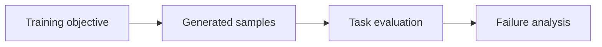

# 07 — Autoencoders, VAEs, GANs, diffusion and language-model training

[Course map](README.md) · [Practicals](../02-practicals/README.md) · [Questions](../03-questions-and-answers/worked-questions.md#lesson-07)

## On this page

- [The idea](#the-idea)
- [Work through it](#work-through-it)
- [Common mistakes and practical limits](#common-mistakes-and-practical-limits)

## The idea

**Analogy:** Generation learns a recipe for plausible examples; plausibility and truth are different targets.

An autoencoder compresses and reconstructs inputs. A VAE introduces a probabilistic latent representation with a reconstruction/likelihood term and a KL penalty against a prior. A GAN trains a generator against a discriminator with competing objectives; instability and mode collapse are practical issues. Diffusion models learn denoising-related predictions over noise levels and use a reverse generation procedure.

Autoregressive language models predict next-token distributions. Pretraining, supervised instruction tuning and preference-based alignment are distinct stages/choices. A low token loss does not establish factual reliability, tool safety or domain competence. Fine-tuning can teach format/style/task behaviour, while retrieval supplies selected external context; neither is universally the correct solution.

Evaluate generations against the actual task: reconstruction and sample metrics, diversity, human judgement with a rubric, factual support, constraint violations and subgroup failures. A single automatic similarity score can miss severe errors. Data contamination and memorization complicate evaluation. Keep datasets, prompts, model versions and evaluation protocols recorded.

## Work through it

A two-outcome next-token model assigning true-token probability 0.8 has negative log loss $-\log.8\approx.2231$. If the true token gets 0.1, loss is 2.3026. Lower loss rewards predictive probability, not an independently verified claim about the world.

A model can generate grammatically convincing but unsupported text because its learned objective is not identical to evidence-grounded answering.

## Common mistakes and practical limits

Do not call a reconstruction model a guaranteed anomaly detector. Generative sample quality and diversity can trade off. Never equate a fluent answer with a verified fact or a benchmark score with deployment readiness.

---

[← Attention, positional information and transformers](lesson-06-attention-and-transformers.md) · [Continue with practicals](../02-practicals/README.md)
