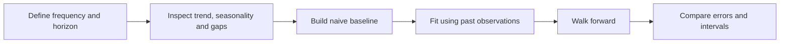
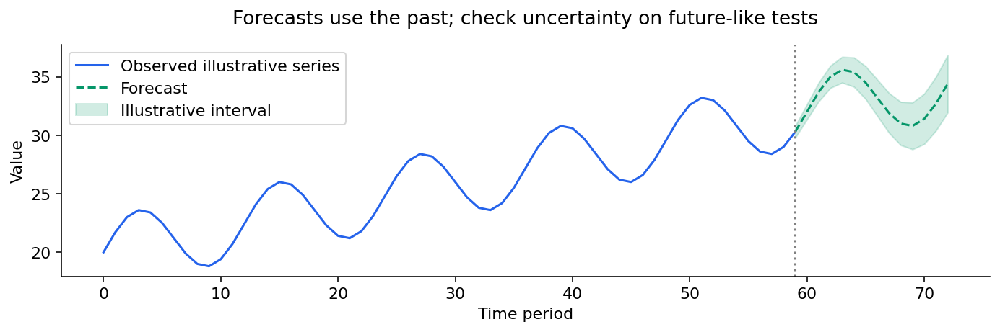

# Time series: patterns, lagged information and honest forecasts

[Subject home](../README.md) · [Theory index](README.md)

A time series is ordered by time. Forecasting asks about values after a prediction date. That order changes validation, preprocessing and feature construction: a model must not learn from information that would only arrive in the future.

## On this page

- [1. Describe what changes over time](#1-describe-what-changes-over-time)
- [2. Baselines and validation](#2-baselines-and-validation)
- [3. Stationarity, differencing and transforms](#3-stationarity-differencing-and-transforms)
- [4. ACF and PACF](#4-acf-and-pacf)
- [5. AR, MA, ARMA and ARIMA](#5-ar-ma-arma-and-arima)
- [6. Features and residuals](#6-features-and-residuals)
- [7. Report useful forecast performance](#7-report-useful-forecast-performance)

## 1. Describe what changes over time

Trend is a sustained long-term movement; seasonality repeats at a meaningful period, such as weekday or month; irregular variation is what remains under a chosen decomposition. A cycle need not have a fixed period. Additive decomposition writes $y_t=T_t+S_t+R_t$; a multiplicative view writes a product and is useful when seasonal size changes with level. Decomposition is a model of patterns, not a proof of their cause.

Choose the time unit, observation timezone and prediction horizon explicitly. Check duplicate timestamps, missing periods, calendar changes, one-off events and revised historical data. A zero-sales day differs from an unobserved day. Forward filling a stock price and filling missing daily demand have different meanings.

## 2. Baselines and validation

A naive forecast repeats the latest value; a seasonal naive forecast repeats the value from the previous matching seasonal period. For weekly seasonality, forecast next Monday using the preceding Monday. A drift forecast extends an average historical change. These are serious baselines, not just toy comparisons.

Use a chronological holdout or rolling/expanding-window backtest. An expanding window retains all past training rows; a rolling window retains a chosen recent window. If production predicts 28 days at once, validate a 28-day horizon instead of evaluating only one-step-ahead forecasts. Use a gap when reporting latency or overlapping feature windows require it.

## 3. Stationarity, differencing and transforms

Weak stationarity means a stable mean, variance and autocovariance depending on lag rather than calendar time. Many classical models use stationary components, while raw business data often has trend or seasonal changes. A unit-root test such as ADF provides evidence under its test model; failing to reject is not proof of a unit root and rejecting is not proof that every stationarity property holds.

First differencing is $\Delta y_t=y_t-y_{t-1}$. Seasonal differencing is $y_t-y_{t-s}$. Too much differencing can add noise and distort structure. A log can stabilize level-related variability for positive values; it does not guarantee stationarity. When reconstructing forecasts, reverse transformations and report the units; exponentiating a predicted log mean does not automatically recover the arithmetic mean.

## 4. ACF and PACF

ACF measures correlation between observations separated by a lag. PACF measures the remaining linear relationship at a lag after accounting for shorter lags in the relevant model. They suggest candidate structures; finite-sample plots are noisy.

| Simple stationary model | Classical pattern to look for |
|---|---|
| AR(p) | PACF cuts off after p; ACF tends to tail off |
| MA(q) | ACF cuts off after q; PACF tends to tail off |
| ARMA | Both often tail off |

These are theoretical guides, not automatic identification rules. Seasonality and differencing change the interpretation. Inspect residual ACF after fitting as well.

## 5. AR, MA, ARMA and ARIMA

An AR(1) model uses its own previous value:

$$y_t=c+\phi y_{t-1}+\epsilon_t.$$

If $c=2$, $\phi=0.5$ and the latest value is 10, the next conditional forecast is 7; the following is 5.5. For a stationary AR(1), $|\phi|<1$ and the long-run mean is $c/(1-\phi)=4$. White noise has constant mean/variance and zero autocorrelation under the usual definition; it need not be Gaussian or fully independent.

An MA(1) model uses past **innovations/errors**, $y_t=\mu+\epsilon_t+\theta\epsilon_{t-1}$. It is not the same as a rolling moving-average smoother. ARMA combines AR and MA terms. ARIMA(p,d,q) adds d differencing operations. Seasonal ARIMA adds seasonal orders (P,D,Q) and period s. SARIMAX can include external regressors; their future values must be known or separately forecast.

Compare a small defensible set of models using development backtests and residual diagnostics. Information criteria can help model comparison under their assumptions; they do not replace future-like validation or the baseline.

## 6. Features and residuals

For machine-learning forecasting, lag features use past values; rolling features must be shifted so the current/future target is excluded. Calendar features can be known ahead; future revenue is not. A model trained recursively on one-step targets may accumulate errors when its own predictions become later inputs. Direct multi-horizon models make a different trade-off.

Residuals should be examined for bias, remaining autocorrelation, changing variance and event-specific failure. A prediction interval expresses uncertainty under a model; its coverage needs checking. An interval typically widens with horizon, but the exact pattern depends on the model and information available.

## 7. Report useful forecast performance

MAE and RMSE keep interpretable units; RMSE emphasizes large errors. MAPE divides by actual values and is unstable or undefined near zero. MASE compares scaled errors with a naive reference under its definition. Evaluate by horizon, group and important demand regime. A strong average can hide a failure on peak days.

The existing candy, news-demand and stock-price practicals are examples to inspect. A historical fit to a stock series is not evidence of a profitable trading strategy. For any deployment, include data latency, baseline, forecast horizon, interval coverage and a retraining rule.

[Try the practicals](../02-practicals/README.md)
