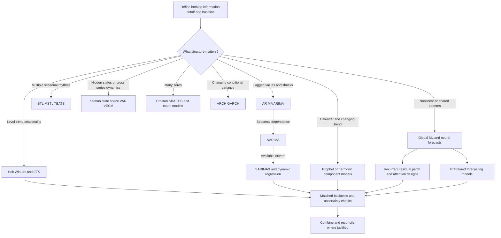

# The forecasting algorithm story: patterns, dependence, drivers and uncertainty

[Subject home](../README.md) · [Foundation course](README.md) · [Practicals](../02-practicals/README.md)

Begin with the six foundation lessons, then follow these worked model chapters. Methods branch because the forecasting questions differ. The list includes classical, component, ML, neural, pretrained and variance/reconciliation families; it is not a universal league table.

## Follow the branches in this reading order

### 01. [AR, MA, ARMA and ARIMA](algorithms/01-ar-ma-arima.md)

**Problem:** A last-value forecast ignores predictable relationships among earlier values and errors.

**Change:** An AR(p) uses lagged values: $y_t=c+\sum_{i=1}^p\phi_i y_{t-i}+\epsilon_t$.

**Still consider:** ARIMA is a compact, interpretable classical method for a single series with useful linear dependence.

### 02. [SARIMA, SARIMAX and dynamic regression](algorithms/02-sarima-sarimax.md)

**Problem:** Ordinary short-lag ARIMA may not represent repeated weekly or yearly dependence parsimoniously.

**Change:** Write a seasonal model as $\phi(B)\Phi(B^m)(1-B)^d(1-B^m)^D y_t=c+\theta(B)\Theta(B^m)\epsilon_t$, where B is the lag operator and m the seasonal period.

**Still consider:** SARIMA handles one prominent seasonal period with explicit dependence, but parameter searches can become costly and long/multiple periods awkward.

### 03. [Smoothing, Holt, damped trends, Holt–Winters and ETS](algorithms/03-ets-holt-winters.md)

**Problem:** A flat level estimate cannot follow a sustained trend; a trend-only method cannot follow recurring seasonality.

**Change:** Simple smoothing updates $\ell_t=\alpha y_t+(1-\alpha)\ell_{t-1}$.

**Still consider:** Fast and useful for local level/trend/seasonal patterns, with clear components.

### 04. [STL/MSTL, Theta, Fourier regression, BATS and TBATS](algorithms/04-stl-theta-tbats.md)

**Problem:** One fixed seasonal pattern or a small seasonal lag model can be too restrictive for hourly data with daily and weekly rhythms.

**Change:** STL separates trend, seasonality and remainder using local smoothing; MSTL extends decomposition to multiple seasonalities.

**Still consider:** Decomposition is interpretable and can isolate complex rhythms; it can fail at changing seasonality, outliers and boundaries.

### 05. [Prophet: trend, changepoints, seasonality, holidays and regressors](algorithms/05-prophet.md)

**Problem:** Business forecasts often need explicit calendar effects, holidays and analyst-adjustable trend flexibility.

**Change:** A useful additive form is $y(t)=g(t)+s(t)+h(t)+\epsilon_t$: trend, seasonal terms, event/holiday effects and residual noise.

**Still consider:** Useful when interpretable trend/calendar components and operational configurability matter.

### 06. [Structural state-space models, Kalman filters, VAR and VECM](algorithms/06-states-and-multivariate.md)

**Problem:** Observed values may reflect evolving hidden level/trend states.

**Change:** A linear Gaussian state-space model uses $x_t=F x_{t-1}+w_t$ and $y_t=H x_t+v_t$.

**Still consider:** State-space models handle latent dynamics and measurement uncertainty elegantly but depend on model/noise assumptions.

### 07. [Croston, SBA, TSB and intermittent-demand forecasting](algorithms/07-intermittent-demand.md)

**Problem:** Many spare-parts/product series contain long zero runs and occasional positive demand.

**Change:** Croston updates smoothed positive-demand size z and interval p when a nonzero event occurs, and forecasts z/p between events.

**Still consider:** Croston-style methods are understandable small-data baselines, but do not naturally model every covariate, dependence or uncertainty pattern.

### 08. [Lagged regression, random forests, boosting and global forecasting](algorithms/08-ml-forecasting.md)

**Problem:** Linear dependence and fixed seasonal structure can miss nonlinear interactions among lags, calendar and known drivers.

**Change:** Create features from available lags, trailing summaries, calendar, static series attributes and known future covariates.

**Still consider:** Flexible interactions and scalable tabular training are strengths; feature leakage, recursive error accumulation, extrapolation and sparse histories are common weaknesses.

### 09. [DeepAR, TCN, N-BEATS and N-HiTS](algorithms/09-neural-global-models.md)

**Problem:** Hand-selected lag features and separate local models can fail to exploit a large collection of related series.

**Change:** DeepAR trains an autoregressive recurrent model across related series, outputting parameters of a probability distribution and maximizing a likelihood.

**Still consider:** Sharing and flexible representation can help, but small/local datasets, distribution shift, nonnegative support, dependence and model/compute cost remain important.

### 10. [TFT, Informer/Autoformer families, PatchTST and iTransformer](algorithms/10-attention-forecasters.md)

**Problem:** Long contexts, mixed covariates and multivariate relationships motivate architectures beyond a basic recurrent forecaster.

**Change:** Temporal Fusion Transformer combines recurrent/local processing, variable-selection/gating components and attention for multihorizon prediction, commonly with quantile objectives.

**Still consider:** Attention can connect long-range/multivariate structure, but performance depends on tokenization, normalization, scale, horizon and data.

### 11. [Chronos, TimesFM and the pretrained forecasting branch](algorithms/11-pretrained-forecasting.md)

**Problem:** Fitting a dedicated model for every new series can be costly or data-limited.

**Change:** The original Chronos formulation scales/quantizes values into tokens and trains language-model-style architectures with a next-token objective.

**Still consider:** Fast task adaptation and shared patterns are promising; domain mismatch, training overlap, scale handling, covariate limits, interval calibration and serving constraints remain.

### 12. [ARCH, GARCH and conditional volatility](algorithms/12-volatility.md)

**Problem:** A return series can have weak predictable mean but clusters of large/small movements.

**Change:** An ARCH model makes conditional variance depend on past squared shocks.

**Still consider:** Useful for conditional risk/volatility measurement under stated assumptions.

### 13. [Forecast combinations, hierarchies and probabilistic reconciliation](algorithms/13-reconciliation-and-combination.md)

**Problem:** No one model is consistently best across every series/horizon, and independently predicted totals may not add up.

**Change:** A fixed or learned weighted average combines base forecasts.

**Still consider:** Combination can improve stability at extra training/serving cost; learned weights can overfit.

## How to compare alternatives

Use the same task, eligible data, split/horizon and compute budget. State the objective, assumptions, training/update procedure, important settings and failure cases. A newer publication can address one bottleneck while being worse on another. A survey row identifies a family; it does not pretend to derive every research variant.

For a method you study, complete this sentence: “I would consider it because ___; it works by ___; I would compare it with ___ using ___; I would avoid or investigate it when ___.” Recalculate the worked examples before selecting by a method name.
