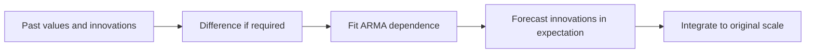
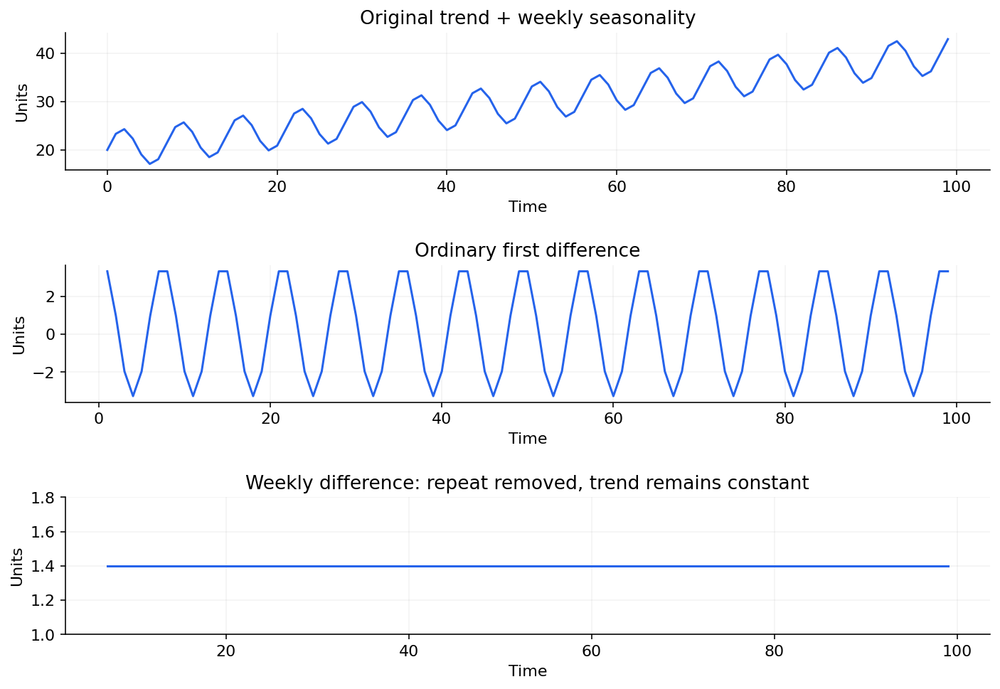

# 01 — AR, MA, ARMA and ARIMA

[Algorithm story](../ALGORITHM-STORY.md) · [Algorithm index](README.md) · [Practicals](../../02-practicals/README.md)

## On this page

- [1. Why this branch exists](#1-why-this-branch-exists)
- [2. How it works and learns](#2-how-it-works-and-learns)
- [3. Calculate a small example](#3-calculate-a-small-example)
- [4. Advantages, limitations and related alternatives](#4-advantages-limitations-and-related-alternatives)
- [5. How to choose and validate it](#5-how-to-choose-and-validate-it)

## 1. Why this branch exists

A last-value forecast ignores predictable relationships among earlier values and errors. AR and MA add different kinds of memory. ARMA combines them for a suitable stationary series. When levels drift, ARIMA adds differencing before modelling that dependence. This is one modelling branch, not a claim that all time series need differencing.

## 2. How it works and learns

An AR(p) uses lagged values: $y_t=c+\sum_{i=1}^p\phi_i y_{t-i}+\epsilon_t$. An MA(q) uses current/past innovations: $y_t=\mu+\epsilon_t+\sum_{j=1}^q\theta_j\epsilon_{t-j}$. An innovation is the unpredictable part under the model, not a rolling average of observations. ARMA combines both terms. ARIMA(p,d,q) applies the ARMA structure to $\Delta^d y_t$.

Estimate coefficients and innovation scale through a suitable likelihood or conditional estimation procedure. Select orders with a restrained candidate search, information criteria under comparable fits, and chronological validation. Stationarity/invertibility conditions and the treatment of constants differ across specifications. Forecast future innovations by their model expectation, usually zero, rather than pretending their realized future values are known. Residual ACF and a suitable whiteness test can expose remaining dependence but do not prove the forecast is optimal.

Ordinary and weekly differencing remove different structure.

## 3. Calculate a small example

For AR(1), $c=2,\phi=.5,y_t=10$: one-step mean is 7 and two-step mean is 5.5. With $|\phi|<1$, the stationary mean is 4. For a random walk, ARIMA(0,1,0) without drift predicts the last level: differencing does not automatically make it more sophisticated than the naive baseline.

For observed levels [10,12,15], first differences are[2,3]. If the next predicted difference is 2.5, reconstruct the next level as 17.5. Every later horizon must be integrated back consistently.

## 4. Advantages, limitations and related alternatives

ARIMA is a compact, interpretable classical method for a single series with useful linear dependence. It struggles with nonlinear effects, structural breaks, multiple long seasonal periods and many related series. An MA term models shocks, not external business drivers. Seasonal dependence motivates SARIMA; available drivers motivate regression with ARIMA errors; nonlinear/global patterns motivate other families.

## 5. How to choose and validate it

Tune p,d,q, trend/constant convention and training window. Do not difference solely until a test becomes significant. Compare the required horizons against naive, seasonal naive and ETS using the same origins. Inspect bias, residual dependence and interval coverage.

---

[SARIMA, SARIMAX and dynamic regression →](02-sarima-sarimax.md)
