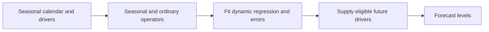

# 02 — SARIMA, SARIMAX and dynamic regression

[Algorithm story](../ALGORITHM-STORY.md) · [Algorithm index](README.md) · [Practicals](../../02-practicals/README.md)

## On this page

- [1. Why this branch exists](#1-why-this-branch-exists)
- [2. How it works and learns](#2-how-it-works-and-learns)
- [3. Calculate a small example](#3-calculate-a-small-example)
- [4. Advantages, limitations and related alternatives](#4-advantages-limitations-and-related-alternatives)
- [5. How to choose and validate it](#5-how-to-choose-and-validate-it)

## 1. Why this branch exists

Ordinary short-lag ARIMA may not represent repeated weekly or yearly dependence parsimoniously. Seasonal ARIMA adds lag-m operators. External variables require another distinction: a calendar effect or promotion is not the same thing as autocorrelated errors.

## 2. How it works and learns

Write a seasonal model as $\phi(B)\Phi(B^m)(1-B)^d(1-B^m)^D y_t=c+\theta(B)\Theta(B^m)\epsilon_t$, where B is the lag operator and m the seasonal period. Lowercase p,d,q describe nonseasonal terms; uppercase P,D,Q describe seasonal terms. Seasonal and ordinary differencing answer different questions and excessive differencing adds noise.

A regression-with-ARIMA-errors specification is $y_t=x_t^T\beta+n_t$, where n follows an ARIMA/SARIMA process. Software often exposes this under a SARIMAX interface; conventions and intercept interpretations vary. Required future x values must be genuinely known, separately forecast or scenario-defined. Fit likelihood-based parameters, then assess residuals and out-of-origin forecasts.

## 3. Calculate a small example

For weekly seasonal differencing, $w_t=y_t-y_{t-7}$. If last Monday was 100 and the predicted weekly difference for next Monday is 5, its level forecast is 105. A model containing both $(1-B)$ and $(1-B^7)$ has a different interpretation from simply subtracting last week once.

An illustrative regression $y_t=20+3\,promotion_t+n_t$ adds 3 units when the known promotion flag is 1, conditional on the model. It is not automatically the causal promotion effect because promotion assignment may be confounded.

## 4. Advantages, limitations and related alternatives

SARIMA handles one prominent seasonal period with explicit dependence, but parameter searches can become costly and long/multiple periods awkward. SARIMAX uses drivers but can fail when their future values are unavailable or the relationship changes. Fourier regression, TBATS, Prophet and global ML offer alternative representations, not universally better seasonal models.

## 5. How to choose and validate it

Tune seasonal period from the calendar/domain, then restrained p,d,q,P,D,Q, regressors and window. Backtest holiday/event periods and verify covariate release times. Keep future realized weather or demand out of training-time forecast inputs.

---

[← AR, MA, ARMA and ARIMA](01-ar-ma-arima.md) · [Smoothing, Holt, damped trends, Holt–Winters and ETS →](03-ets-holt-winters.md)
