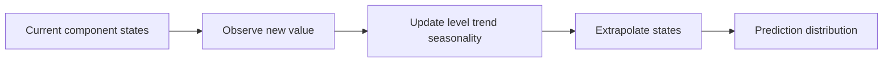

# 03 — Smoothing, Holt, damped trends, Holt–Winters and ETS

[Algorithm story](../ALGORITHM-STORY.md) · [Algorithm index](README.md) · [Practicals](../../02-practicals/README.md)

## On this page

- [1. Why this branch exists](#1-why-this-branch-exists)
- [2. How it works and learns](#2-how-it-works-and-learns)
- [3. Calculate a small example](#3-calculate-a-small-example)
- [4. Advantages, limitations and related alternatives](#4-advantages-limitations-and-related-alternatives)
- [5. How to choose and validate it](#5-how-to-choose-and-validate-it)

## 1. Why this branch exists

A flat level estimate cannot follow a sustained trend; a trend-only method cannot follow recurring seasonality. Smoothing methods add interpretable evolving components rather than explicitly modelling lagged innovations in the same way as ARIMA.

## 2. How it works and learns

Simple smoothing updates $\ell_t=\alpha y_t+(1-\alpha)\ell_{t-1}$. Holt adds a slope, for example $b_t=\beta(\ell_t-\ell_{t-1})+(1-\beta)b_{t-1}$ and forecast $\ell_t+h b_t$. A damped forecast replaces h by $\sum_{i=1}^h\varphi^i$, limiting indefinite trend growth when $0<\varphi<1$.

Holt–Winters adds a seasonal state, with additive or multiplicative formulations under compatible data assumptions. ETS specifies error, trend and seasonal components in a state-space model; its likelihood and interval behaviour depend on that specification. The smoothing update equations and innovations model belong together. Parameters and initial states are estimated, not selected by a universal alpha of 0.1.

## 3. Calculate a small example

Level 10, observation 14, alpha.25 gives 11. If level 100 and slope 4, ordinary Holt predicts 120 at horizon 5. With damping.8, the trend contribution is $4(.8+.64+.512+.4096+.32768)=10.75712$, so forecast 110.75712.

An additive seasonal adjustment of−10 means ten fewer units regardless of level. A multiplicative factor.9 means 10% below the trend; these differ as the series grows.

## 4. Advantages, limitations and related alternatives

Fast and useful for local level/trend/seasonal patterns, with clear components. Persistent extrapolated trends, abrupt regime changes, external drivers and complex multiple seasonality remain challenges. ETS and ARIMA overlap in some special cases but are distinct modelling frameworks. Structural/Kalman formulations extend latent-state reasoning; harmonic and multiple-seasonal methods address other calendar structures.

## 5. How to choose and validate it

Tune component form, damping, seasonal period and estimation window, then compare interval coverage and horizon-specific errors. Multiplicative components require compatible positive values. Use the same origins as competing models, not in-sample smoothness.

---

[← SARIMA, SARIMAX and dynamic regression](02-sarima-sarimax.md) · [STL/MSTL, Theta, Fourier regression, BATS and TBATS →](04-stl-theta-tbats.md)
