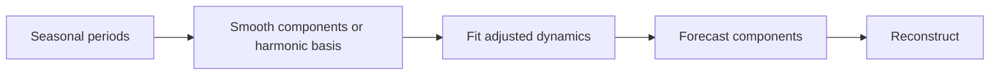

# 04 — STL/MSTL, Theta, Fourier regression, BATS and TBATS

[Algorithm story](../ALGORITHM-STORY.md) · [Algorithm index](README.md) · [Practicals](../../02-practicals/README.md)

## On this page

- [1. Why this branch exists](#1-why-this-branch-exists)
- [2. How it works and learns](#2-how-it-works-and-learns)
- [3. Calculate a small example](#3-calculate-a-small-example)
- [4. Advantages, limitations and related alternatives](#4-advantages-limitations-and-related-alternatives)
- [5. How to choose and validate it](#5-how-to-choose-and-validate-it)

## 1. Why this branch exists

One fixed seasonal pattern or a small seasonal lag model can be too restrictive for hourly data with daily and weekly rhythms. Decomposition and harmonic methods represent that structure differently; they are not all successive versions of one algorithm.

## 2. How it works and learns

STL separates trend, seasonality and remainder using local smoothing; MSTL extends decomposition to multiple seasonalities. A forecasting pipeline predicts the seasonally adjusted series and adds extrapolated seasonal components back. Decomposition must be refitted within each historical origin to avoid using future observations.

Theta methods modify a series using trend/curvature ideas and combine forecasts from resulting theta lines; the classic two-line formulation has connections to smoothing with drift. Fourier regression models seasonality with sine/cosine pairs, optionally using ARIMA errors. BATS combines selected Box–Cox, ARMA-error, trend and seasonal-state components; TBATS uses trigonometric seasonal representation to handle complex periods. These names specify model families, not a promise of automatic superior accuracy.

## 3. Calculate a small example

A Fourier pair for period 7 is $a\sin(2\pi t/7)+b\cos(2\pi t/7)$. At t=0 the sine term is 0 and cosine term b. Several harmonics allow more complex seasonal shape; multiple periods can add daily and weekly bases. More harmonics also add flexibility and can overfit.

If trend forecast 120 and seasonal component−8, additive reconstruction is 112. A multiplicative decomposition would require a different reconstruction rule.

## 4. Advantages, limitations and related alternatives

Decomposition is interpretable and can isolate complex rhythms; it can fail at changing seasonality, outliers and boundaries. Harmonics compress long periods but assume a useful smooth periodic structure. TBATS can be computationally expensive; a simple harmonic regression may suffice. Prophet offers another component model with changepoints/events, while learned global models can share patterns across series.

## 5. How to choose and validate it

Tune seasonal periods, decomposition smoothness, robustness and harmonic counts using complete backtests. Check calendar effects and noninteger/long periods deliberately. Do not estimate the decomposition once on all data and then call the remainder forecasts leakage-free.

---

[← Smoothing, Holt, damped trends, Holt–Winters and ETS](03-ets-holt-winters.md) · [Prophet: trend, changepoints, seasonality, holidays and regressors →](05-prophet.md)
