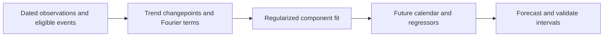
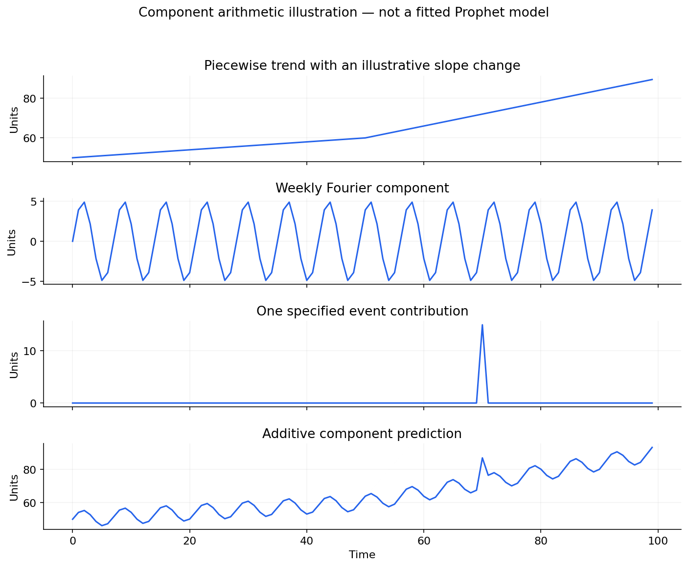

# 05 — Prophet: trend, changepoints, seasonality, holidays and regressors

[Algorithm story](../ALGORITHM-STORY.md) · [Algorithm index](README.md) · [Practicals](../../02-practicals/README.md)

## On this page

- [1. Why this branch exists](#1-why-this-branch-exists)
- [2. How it works and learns](#2-how-it-works-and-learns)
- [3. Calculate a small example](#3-calculate-a-small-example)
- [4. Advantages, limitations and related alternatives](#4-advantages-limitations-and-related-alternatives)
- [5. How to choose and validate it](#5-how-to-choose-and-validate-it)

## 1. Why this branch exists

Business forecasts often need explicit calendar effects, holidays and analyst-adjustable trend flexibility. Prophet combines these components in a configurable regression-style forecasting framework. The historic name Facebook Prophet refers to this project; it is not an ARIMA variant or an LSTM.

## 2. How it works and learns

A useful additive form is $y(t)=g(t)+s(t)+h(t)+\epsilon_t$: trend, seasonal terms, event/holiday effects and residual noise. Piecewise trend terms allow slope changes at candidate changepoints under regularization. Seasonal components use Fourier bases. Growth choices include a linear trend and a logistic option with a meaningful capacity setup; multiplicative seasonality changes how effects relate to trend. Additional regressors need future values available under the forecast task.

Fitting estimates component coefficients and trend changes under likelihood/prior choices. Changepoint prior scale controls trend flexibility; seasonal/holiday regularization and Fourier orders control other flexibility. A large context or many changepoints does not remove the need for validation. Output columns yhat/yhat_lower/yhat_upper are predictions/intervals under model assumptions, not guaranteed bounds.

The Python interface conventionally uses a dataframe with ds timestamps and y targets, then a fitted Prophet object and a future dataframe. Use the project documentation for exact installed-version APIs; an old import from fbprophet is not the same package name as the modern prophet interface.

Synthetic component arithmetic; this plot is not a fitted Prophet model.

## 3. Calculate a small example

Suppose a fitted component model predicts trend 100, weekly effect−10 and holiday effect+25: additive forecast 115. In a simplified multiplicative seasonal form with trend 100 and seasonal effect−.10 plus additive holiday 25, prediction is also 115 here, but at trend 200 it becomes 205 rather than 215. State which components are additive/multiplicative.

For a synthetic promotion regressor, a forecast needs the planned future promotion value. Filling future values with realized outcomes would leak information. A capacity cap 500 in logistic growth is a modelling input, not a discovered physical business limit.

## 4. Advantages, limitations and related alternatives

Useful when interpretable trend/calendar components and operational configurability matter. It can miss residual autocorrelation, abrupt regime shifts and complicated nonlinear interactions; a small dataset may not identify yearly seasonality reliably. It is not guaranteed to outperform seasonal naive, ETS, SARIMA or ML, and irregular timestamps do not make missingness harmless. Compare rather than selecting by brand.

## 5. How to choose and validate it

Backtest several cutoffs at the actual horizon; tune changepoint flexibility, seasonal modes/orders, holidays, regressors and growth assumptions. Evaluate bias and interval coverage around holidays and trend changes. Reference: [official Prophet quick-start source](https://github.com/meta/prophet/blob/main/docs/_docs/quick_start.md).

---

[← STL/MSTL, Theta, Fourier regression, BATS and TBATS](04-stl-theta-tbats.md) · [Structural state-space models, Kalman filters, VAR and VECM →](06-states-and-multivariate.md)
