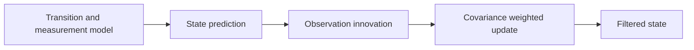
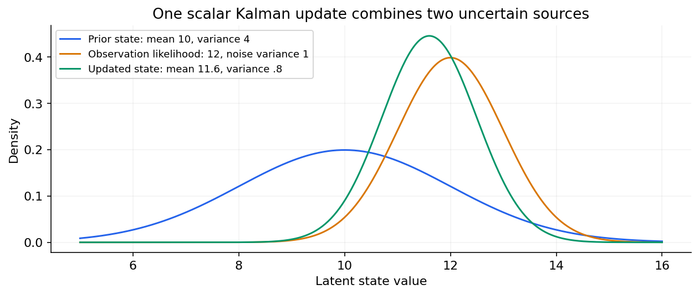

# 06 — Structural state-space models, Kalman filters, VAR and VECM

[Algorithm story](../ALGORITHM-STORY.md) · [Algorithm index](README.md) · [Practicals](../../02-practicals/README.md)

## On this page

- [1. Why this branch exists](#1-why-this-branch-exists)
- [2. How it works and learns](#2-how-it-works-and-learns)
- [3. Calculate a small example](#3-calculate-a-small-example)
- [4. Advantages, limitations and related alternatives](#4-advantages-limitations-and-related-alternatives)
- [5. How to choose and validate it](#5-how-to-choose-and-validate-it)

## 1. Why this branch exists

Observed values may reflect evolving hidden level/trend states. Several series may also help predict one another. Latent-state filtering and multivariate lag models address different aspects of that problem; one does not replace the other.

## 2. How it works and learns

A linear Gaussian state-space model uses $x_t=F x_{t-1}+w_t$ and $y_t=H x_t+v_t$. The Kalman filter predicts the latent state/covariance, compares the observation with its predicted value, then updates using a covariance-weighted gain. A smoother can use future observations to estimate past states; using that smoothed state in an online backtest would leak future information unless the protocol permits it.

VAR(p) fits each variable from lags of all included variables: $y_t=c+\sum_{i=1}^p A_i y_{t-i}+\epsilon_t$. Parameter count grows quickly. VECM represents selected cointegrated nonstationary systems with long-run adjustment and short-run changes. Cointegration is not the same as merely high correlation. Granger predictive precedence is not automatically intervention causality.

The observation and prior uncertainty determine the scalar update.

## 3. Calculate a small example

Scalar prior state mean 10, variance 4; observation 12 with noise variance 1. Gain $K=4/(4+1)=.8$, updated mean 11.6 and variance.8 under this simple model. The measurement and state uncertainties determine the weighting.

For a two-series VAR(1), each next value uses both previous values. Ten variables with many lags need substantially more coefficients than one univariate AR model; shrinkage/Bayesian estimation can reduce instability under appropriate priors.

## 4. Advantages, limitations and related alternatives

State-space models handle latent dynamics and measurement uncertainty elegantly but depend on model/noise assumptions. Extended/unscented/particle filtering address selected nonlinear/non-Gaussian settings at additional complexity. VAR/VECM model cross-series relationships but need sufficient history, suitable stationarity/cointegration handling and stable relations. Global neural models offer another sharing mechanism.

## 5. How to choose and validate it

Choose state transitions/noise models or lag order/variable set from the scientific/business question; estimate and backtest. Validate each series/horizon, inspect stability and compare with independent univariate baselines. Avoid treating filtered confidence as evidence that the hidden state is literally the true business mechanism.

---

[← Prophet: trend, changepoints, seasonality, holidays and regressors](05-prophet.md) · [Croston, SBA, TSB and intermittent-demand forecasting →](07-intermittent-demand.md)
