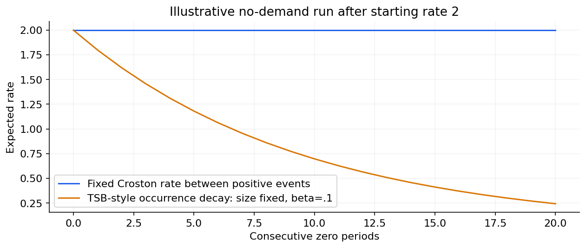

# 07 — Croston, SBA, TSB and intermittent-demand forecasting

[Algorithm story](../ALGORITHM-STORY.md) · [Algorithm index](README.md) · [Practicals](../../02-practicals/README.md)

## On this page

- [1. Why this branch exists](#1-why-this-branch-exists)
- [2. How it works and learns](#2-how-it-works-and-learns)
- [3. Calculate a small example](#3-calculate-a-small-example)
- [4. Advantages, limitations and related alternatives](#4-advantages-limitations-and-related-alternatives)
- [5. How to choose and validate it](#5-how-to-choose-and-validate-it)

## 1. Why this branch exists

Many spare-parts/product series contain long zero runs and occasional positive demand. Ordinary percentage errors and a model that predicts only zero can give misleading impressions. Croston-style methods separate positive size from arrival timing.

## 2. How it works and learns

Croston updates smoothed positive-demand size z and interval p when a nonzero event occurs, and forecasts z/p between events. Zero periods increase the time since the last arrival rather than updating the positive size with zero. Initialization and update conventions matter. Original Croston estimates can be biased under their stochastic assumptions.

SBA applies a bias adjustment, commonly $(1-\alpha/2)z/p$ under its standard shared-smoothing convention. TSB smooths occurrence probability every period and positive size when demand occurs, forecasting probability×size; this allows forecasts to decay during prolonged inactivity. Other variants, renewal/count models and hurdle models address related assumptions. They are not interchangeable just because all data have zeros.

Croston and TSB-style occurrence updating differ during a zero run.

## 3. Calculate a small example

Smoothed positive size 10 and interval 5 give Croston forecast 2 units/period. With alpha.2, the stated SBA adjustment gives 1.8. If TSB probability.2 and size 10, forecast 2; a zero period with occurrence smoothing.1 changes probability to.18 and forecast 1.8 while size stays 10.

These are expected rates, not a prediction that exactly 1.8 items will be demanded in every period. Inventory needs the distribution over lead-time demand and decision costs.

## 4. Advantages, limitations and related alternatives

Croston-style methods are understandable small-data baselines, but do not naturally model every covariate, dependence or uncertainty pattern. TSB can respond to obsolescence but can also react to a temporary gap. Poisson/negative-binomial or hurdle/global models may help with covariates and distributions, under their assumptions. Evaluate actual inventory consequences separately from point forecast error.

## 5. How to choose and validate it

Tune smoothing, initialization and aggregation frequency. Use time-safe demand histories, distinguish observed sales from unmet demand under stockouts, and compare sensible losses/service simulations. Do not use MAPE blindly with zeros or call a low zero-predictor error operational success.

---

[← Structural state-space models, Kalman filters, VAR and VECM](06-states-and-multivariate.md) · [Lagged regression, random forests, boosting and global forecasting →](08-ml-forecasting.md)
