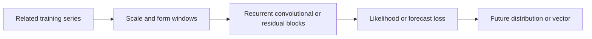

# 09 — DeepAR, TCN, N-BEATS and N-HiTS

[Algorithm story](../ALGORITHM-STORY.md) · [Algorithm index](README.md) · [Practicals](../../02-practicals/README.md)

## On this page

- [1. Why this branch exists](#1-why-this-branch-exists)
- [2. How it works and learns](#2-how-it-works-and-learns)
- [3. Calculate a small example](#3-calculate-a-small-example)
- [4. Advantages, limitations and related alternatives](#4-advantages-limitations-and-related-alternatives)
- [5. How to choose and validate it](#5-how-to-choose-and-validate-it)

## 1. Why this branch exists

Hand-selected lag features and separate local models can fail to exploit a large collection of related series. Neural forecasters learn reusable patterns, but need a clear output objective and enough appropriate data or pretraining.

## 2. How it works and learns

DeepAR trains an autoregressive recurrent model across related series, outputting parameters of a probability distribution and maximizing a likelihood. Sampling recursively produces possible future paths. A Gaussian versus count likelihood changes support and uncertainty assumptions.

A temporal convolutional network uses causal/dilated convolutions to expand historical receptive fields without ordinary sequential recurrence. N-BEATS stacks fully connected blocks with backcast and forecast outputs: a block explains part of the input and adds a forecast contribution. Interpretable basis configurations and generic configurations differ. N-HiTS uses multirate sampling and hierarchical interpolation to represent forecast components across scales, addressing selected long-horizon efficiency/volatility issues.

## 3. Calculate a small example

A residual forecast stack could predict components[10,12]and[1,−1], adding to[11,11]. The backcast updates the historical residual passed to later blocks; that is distinct from simply averaging two independently trained final forecasts.

A probabilistic model predicting mean 20 and SD3 under a Gaussian observation model describes a distribution. Rounding the mean to 20 does not make a count-support likelihood equivalent to Gaussian training.

## 4. Advantages, limitations and related alternatives

Sharing and flexible representation can help, but small/local datasets, distribution shift, nonnegative support, dependence and model/compute cost remain important. Neural models can be worse than simple baselines. N-HiTS is not a universal replacement for N-BEATS; they encode different multiscale design choices. Choose the relevant likelihood/point objective and compare fairly.

## 5. How to choose and validate it

Tune context/horizon, scaling, architecture, likelihood/loss, regularization, training schedule and pooling. Evaluate calibration and sample quality for distributions, not only mean RMSE. Primary papers: [DeepAR](https://arxiv.org/abs/1704.04110), [N-BEATS](https://arxiv.org/abs/1905.10437), [N-HiTS](https://arxiv.org/abs/2201.12886).

---

[← Lagged regression, random forests, boosting and global forecasting](08-ml-forecasting.md) · [TFT, Informer/Autoformer families, PatchTST and iTransformer →](10-attention-forecasters.md)
