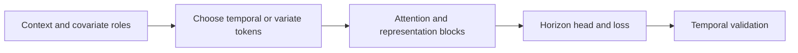

# 10 — TFT, Informer/Autoformer families, PatchTST and iTransformer

[Algorithm story](../ALGORITHM-STORY.md) · [Algorithm index](README.md) · [Practicals](../../02-practicals/README.md)

## On this page

- [1. Why this branch exists](#1-why-this-branch-exists)
- [2. How it works and learns](#2-how-it-works-and-learns)
- [3. Calculate a small example](#3-calculate-a-small-example)
- [4. Advantages, limitations and related alternatives](#4-advantages-limitations-and-related-alternatives)
- [5. How to choose and validate it](#5-how-to-choose-and-validate-it)

## 1. Why this branch exists

Long contexts, mixed covariates and multivariate relationships motivate architectures beyond a basic recurrent forecaster. Attention offers flexible interactions, but full temporal attention has cost and representation trade-offs.

## 2. How it works and learns

Temporal Fusion Transformer combines recurrent/local processing, variable-selection/gating components and attention for multihorizon prediction, commonly with quantile objectives. Its static, known-future and observed-history inputs have different availability roles. Internal weights need careful interpretation and are not causal proof.

Informer-style designs explore attention/long-sequence efficiency; Autoformer/FEDformer-style designs explore decomposition and frequency/dependence representations. PatchTST forms temporal patches and uses channel-independent shared weights in its original design, reducing token count and preserving local structure. iTransformer instead treats variates as tokens to model cross-variable interactions while using a different temporal representation. These are architecture branches, not one ordered series of universally superior versions.

## 3. Calculate a small example

A context of 96 observations split into nonoverlapping patches of 16 becomes 6 tokens per channel before embedding, rather than 96 point tokens. Actual implementations can use stride/overlap and padding. Full attention score counts over 6 tokens are 36 rather than 9216 over 96, but total model cost includes embeddings, heads, layers and channels.

A known future holiday flag is valid; tomorrow's realized demand is not. The most elaborate network can still learn leakage if inputs are wrong.

## 4. Advantages, limitations and related alternatives

Attention can connect long-range/multivariate structure, but performance depends on tokenization, normalization, scale, horizon and data. Linear models such as DLinear/NLinear are important comparisons that test whether architectural complexity adds value. Memory efficiency does not establish predictive superiority or calibrated intervals.

## 5. How to choose and validate it

Backtest context length, patch length/stride, channels, input availability, loss and training budget. Compare against simple linear/seasonal and tabular baselines. Primary sources: [TFT](https://arxiv.org/abs/1912.09363), [PatchTST](https://arxiv.org/abs/2211.14730), [iTransformer](https://arxiv.org/abs/2310.06625).

---

[← DeepAR, TCN, N-BEATS and N-HiTS](09-neural-global-models.md) · [Chronos, TimesFM and the pretrained forecasting branch →](11-pretrained-forecasting.md)
