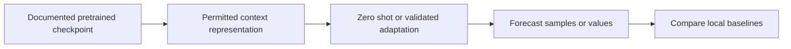

# 11 — Chronos, TimesFM and the pretrained forecasting branch

[Algorithm story](../ALGORITHM-STORY.md) · [Algorithm index](README.md) · [Practicals](../../02-practicals/README.md)

## On this page

- [1. Why this branch exists](#1-why-this-branch-exists)
- [2. How it works and learns](#2-how-it-works-and-learns)
- [3. Calculate a small example](#3-calculate-a-small-example)
- [4. Advantages, limitations and related alternatives](#4-advantages-limitations-and-related-alternatives)
- [5. How to choose and validate it](#5-how-to-choose-and-validate-it)

## 1. Why this branch exists

Fitting a dedicated model for every new series can be costly or data-limited. Pretrained forecasting models learn patterns from many earlier series and attempt zero-shot or adapted forecasting on a new one. This changes where learning happened, not the need for evaluation.

## 2. How it works and learns

The original Chronos formulation scales/quantizes values into tokens and trains language-model-style architectures with a next-token objective. Generated token sequences can be decoded into sample forecasts. TimesFM's original formulation uses a pretrained decoder-only time-series model with patch-based representation. Other families such as Moirai, Lag-Llama and hosted TimeGPT-style services explore different data, architectures and distributions; capabilities depend on the specific model/checkpoint/version.

Zero-shot means no task-specific parameter training in the stated protocol; using context history is still part of prediction. Fine-tuning, covariate support, output distributions, context/horizon limits and commercial/privacy terms vary. Do not assume all members support all input types or share training data. Check a current model card before using an implementation.

## 3. Calculate a small example

Suppose a pretrained model forecasts the next 24 hours from a seven-day history. Hold out the actual next 24 hours, issue the forecast from the same cutoff as a seasonal-naive/local model and score both. Selecting the context length after examining that holdout makes it a tuning set, not a final test.

An apparently excellent public benchmark can be contaminated if its series or derived versions appeared in pretraining. Evaluate temporal/domain transfer and documented overlap rather than equating zero-shot with automatically uncontaminated.

## 4. Advantages, limitations and related alternatives

Fast task adaptation and shared patterns are promising; domain mismatch, training overlap, scale handling, covariate limits, interval calibration and serving constraints remain. A large pretrained model is not guaranteed to beat a good local baseline. “Newer” describes a branch in research/deployment, not a universal ranking.

## 5. How to choose and validate it

Compare current documented checkpoints under the same horizons and data permissions. Keep source versions, latency, compute/cost and uncertainty evidence. Original primary descriptions: [Chronos](https://arxiv.org/abs/2403.07815) and [TimesFM](https://arxiv.org/abs/2310.10688); these links explain their original designs, not every later release.

---

[← TFT, Informer/Autoformer families, PatchTST and iTransformer](10-attention-forecasters.md) · [ARCH, GARCH and conditional volatility →](12-volatility.md)
