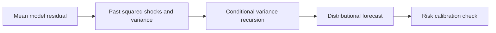

# 12 — ARCH, GARCH and conditional volatility

[Algorithm story](../ALGORITHM-STORY.md) · [Algorithm index](README.md) · [Practicals](../../02-practicals/README.md)

## On this page

- [1. Why this branch exists](#1-why-this-branch-exists)
- [2. How it works and learns](#2-how-it-works-and-learns)
- [3. Calculate a small example](#3-calculate-a-small-example)
- [4. Advantages, limitations and related alternatives](#4-advantages-limitations-and-related-alternatives)
- [5. How to choose and validate it](#5-how-to-choose-and-validate-it)

## 1. Why this branch exists

A return series can have weak predictable mean but clusters of large/small movements. Mean forecasts alone do not model changing conditional variance. ARCH/GARCH address that variance question; they are not general substitutes for sales-level forecasting.

## 2. How it works and learns

An ARCH model makes conditional variance depend on past squared shocks. GARCH adds past conditional variances; a common GARCH(1,1) is $\sigma_t^2=\omega+\alpha\epsilon_{t-1}^2+\beta\sigma_{t-1}^2$. Coefficient constraints and innovation distributions determine positivity/stationarity properties. Parameters are commonly estimated with likelihood/quasi-likelihood methods.

Asymmetric variants such as GJR-GARCH/EGARCH address selected differences between positive/negative shocks. Stochastic-volatility models use a different latent volatility process. These families describe distribution/variance dynamics, not a guaranteed profitable trading signal. Heavy tails, jumps, structural breaks and changing correlations can defeat a simple Gaussian specification.

## 3. Calculate a small example

With omega.1, alpha.2, beta.7, prior squared shock 4 and prior variance 1, next variance is $.1+.2(4)+.7(1)=1.6$, so conditional SD≈1.2649. The forecast mean is a separate component; higher predicted variance is not a predicted positive return.

The usual alpha+beta<1 condition is associated with finite unconditional variance for a standard GARCH setup, with other needed assumptions. It is not a blanket condition for every variant.

## 4. Advantages, limitations and related alternatives

Useful for conditional risk/volatility measurement under stated assumptions. It can miss extreme tails/regimes and does not establish causal or investment conclusions. Multivariate GARCH, stochastic volatility and distributional neural forecasts are related alternatives with different complexity and assumptions.

## 5. How to choose and validate it

Validate the mean/innovation model, variance forecasts, residual diagnostics and decision-specific tail/coverage evidence. Preserve data vintages and avoid future realized volatility inputs. This is educational modelling, not a trading recommendation.

---

[← Chronos, TimesFM and the pretrained forecasting branch](11-pretrained-forecasting.md) · [Forecast combinations, hierarchies and probabilistic reconciliation →](13-reconciliation-and-combination.md)
