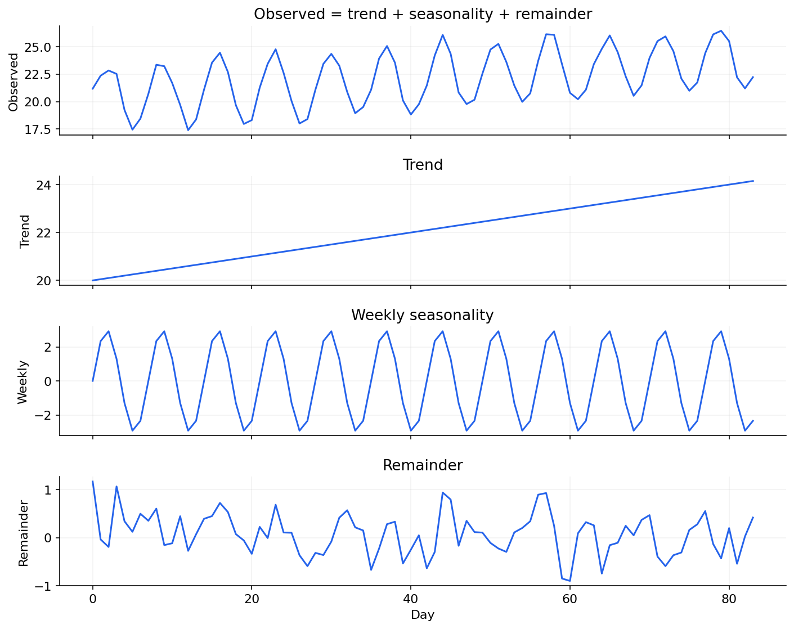

# 02 — Trend, seasonality, transformations, ACF and stationarity

[Course map](README.md) · [Practicals](../02-practicals/README.md) · [Questions](../03-questions-and-answers/worked-questions.md#lesson-02)

Additive trend and seasonality combine into an observed series. See the worked example for its assumptions.

## On this page

- [The idea](#the-idea)
- [Work through it](#work-through-it)
- [Common mistakes and practical limits](#common-mistakes-and-practical-limits)

## The idea

**Analogy:** Decomposition separates a melody from its repeating rhythm and irregular noise.

An additive decomposition writes $y_t=T_t+S_t+R_t$; multiplicative behaviour can motivate logs for positive values. A smooth trend and a repeating seasonal pattern are descriptions, not necessarily independent physical causes. Calendar changes and multiple seasonalities require care.

Weak stationarity assumes a stable mean and autocovariance structure over time. Differencing transforms levels into changes:$\Delta y_t=y_t-y_{t-1}$. Seasonal differencing uses $y_t-y_{t-m}$. Too much differencing can create unnecessary noise. Stationarity tests have model-specific nulls and limited power; combine them with plots and domain context.

ACF measures correlation across lags; PACF describes remaining lag association after intervening lags under its definition. Patterns help suggest candidate models but are not a guaranteed recipe for order selection. Deterministic trend, changing variance and structural breaks can all distort naive interpretations.

## Work through it

A linear sequence[10,12,14,16]has first differences[2,2,2]. A positive multiplicative seasonal series may have larger absolute seasonal swings as its level grows; logs can turn products into sums. After forecasting on a transformed scale, a simple inverse transform of a mean prediction need not equal the mean on the original scale because of nonlinearity.

## Common mistakes and practical limits

A stationary-looking training window can still shift later. Do not estimate a decomposition using future observations before evaluating historical forecasts. Back-transforming intervals and point predictions requires a defined target interpretation.

---

[← Time indices, forecast horizons and naive baselines](lesson-01-time-index-and-baselines.md) · [Exponential smoothing, Holt trends and seasonal ETS →](lesson-03-exponential-smoothing.md)
