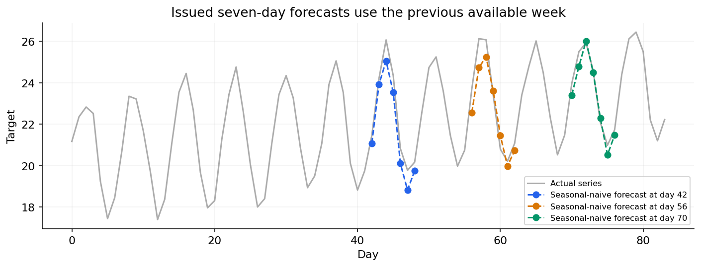
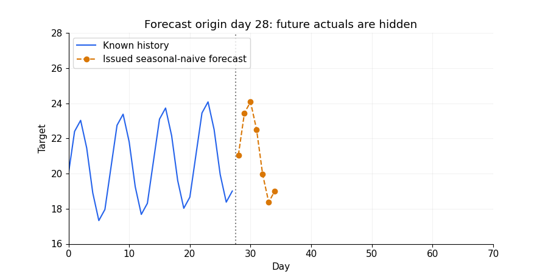

# 05 — Backtesting, metrics, residual diagnostics and intervals

[Course map](README.md) · [Practicals](../02-practicals/README.md) · [Questions](../03-questions-and-answers/worked-questions.md#lesson-05)

Historical forecasts must use only the data available at each origin. See the worked example for its assumptions.

## On this page

- [The idea](#the-idea)
- [Work through it](#work-through-it)
- [Common mistakes and practical limits](#common-mistakes-and-practical-limits)

## The idea

**Analogy:** Backtesting is a time machine with strict rules: you may only bring information from the past.

Use rolling or expanding training windows and evaluate the required horizons across several origins. A gap can account for data latency or overlapping target windows. Hyperparameters and transformations must be selected within the development history, not by repeatedly optimizing final future test scores.

MAE and RMSE summarize different error preferences. MAPE is unstable at zero; MASE scales errors relative to an appropriately defined training naive benchmark. Evaluate per horizon, segment and demand regime. Inspect bias and residual autocorrelation: predictable structure remaining in errors suggests missed information, though sampling noise also matters.

Forecast intervals describe future outcome uncertainty under a method's assumptions. Check empirical coverage and interval width over backtests, including per-horizon and subgroup behaviour. Dependence and structural shift complicate IID conformal guarantees and simple residual resampling. A narrow interval is useful only if its coverage is credible.

As the origin moves, only newly available history enters the forecast.

## Work through it

Actual[10,20], forecasts[12,17]give absolute errors[2,3]and MAE2.5. If a stated training seasonal-naive scale is 5, MASE=.5. That scale must come from the defined training/reference period, not a conveniently chosen test denominator.

A nominal 90% interval covering only 60 of 100 representative outcomes undercovers badly, while an extremely wide interval can cover everything without supporting useful inventory decisions.

## Common mistakes and practical limits

Do not evaluate a one-step-updated procedure as if it were a fixed-origin multistep forecast. Correlated errors make naive independent-error significance calculations misleading. Compare methods on the same origins/horizons.

---

[← AR, MA, ARIMA, SARIMA and dynamic regression](lesson-04-arima-and-dynamic-regression.md) · [Lagged ML, intermittent demand, hierarchies and forecast operations →](lesson-06-forecast-systems.md)
