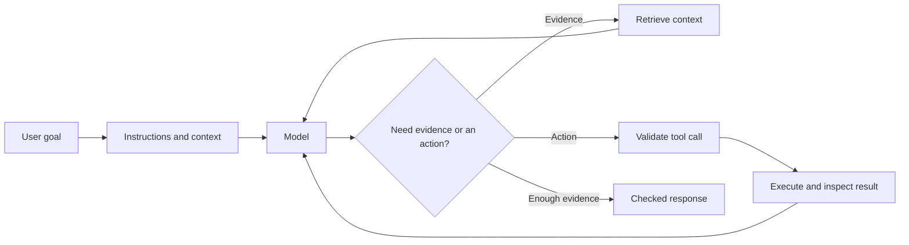
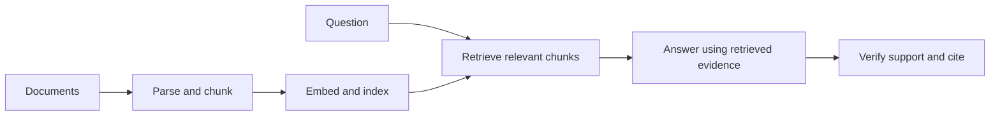

# AI engineering: from a model call to a dependable workflow

[Subject home](../README.md) · [Theory index](README.md)

An AI application combines a model with instructions, data, tools, evaluation and ordinary software. The useful question is not “Can it answer once?” but “Does it complete the task reliably with the information and permissions it has?”

## On this page

- [1. Specify success before adding tools](#1-specify-success-before-adding-tools)
- [2. Context and retrieval-augmented generation](#2-context-and-retrieval-augmented-generation)
- [3. Tools, MCP and agent loops](#3-tools-mcp-and-agent-loops)
- [4. Memory, permissions and reliability](#4-memory-permissions-and-reliability)
- [5. Coding assistants and specification-driven development](#5-coding-assistants-and-specification-driven-development)
- [6. Evaluation and operation](#6-evaluation-and-operation)

## 1. Specify success before adding tools

Define input, expected output, constraints, examples and failure behaviour. A structured output schema makes a result easier to validate; it does not make the values true. Clear roles, concrete examples and explicit task boundaries help, but evaluation decides whether a prompt works. Keep a small set of representative cases and edge cases as a regression set.

For an invoice extractor, success includes correct totals and currency, handling a missing field, and refusing to invent an invoice number. Evaluate field correctness, schema validity, latency and cost separately. Save prompt/configuration versions so changes can be compared.

## 2. Context and retrieval-augmented generation

A model's context is finite. Provide the evidence needed for the current task rather than repeatedly appending every prior document. RAG retrieves relevant material before generation; it does not retrain the model on that material.

Chunk by meaningful units, preserve headings/metadata and evaluate whether correct evidence is retrieved. Embeddings compare semantic patterns; filters restrict scope; reranking can refine candidates. A vector database stores/searches vectors with metadata; nearest-vector results can still be irrelevant. An answer cannot be grounded in a source that was never retrieved.

For a personal learning assistant, compare questions whose answer exists, questions needing several passages, and questions with no answer in the library. Check retrieval recall and answer support separately. Do not duplicate the embedding mathematics here; use the linear-algebra and NLP chapters.

## 3. Tools, MCP and agent loops

A tool has a clear name, input schema, validation, result schema and explicit side effects. MCP is a protocol for exposing tools/resources across clients and servers; it does not itself guarantee that a tool is trustworthy or authorized. Treat retrieved text and tool outputs as data, not new authority to change the task.

An agent loop chooses a step, invokes an allowed tool, observes its result and decides whether to continue. Bound the number of steps and retries. Retry transient failures with an appropriate delay; do not blindly retry a non-idempotent purchase or message, because the first attempt may already have succeeded. Use request IDs or idempotency controls when supported.

A workflow follows predetermined steps. An agent chooses among steps dynamically. Use a simple workflow when its sequence is known; add autonomy where it materially helps. A graph can represent states, branches, tool nodes and review points. Frameworks such as LangChain/LangGraph can help implement these patterns, but the architecture should remain understandable without framework-specific vocabulary.

## 4. Memory, permissions and reliability

Working context holds the current task. Persistent memory stores selected durable facts; it needs ownership, relevance, update and deletion rules. Storing everything creates stale context and retrieval noise. Never treat a remembered preference as permission for a new consequential action.

Use least-privilege tool access, input validation and explicit review at meaningful action boundaries. Separate drafting from sending and proposed changes from executed mutations. Validate tool arguments and inspect results before claiming success. Do not place secrets inside prompts, logs or committed notebooks.

## 5. Coding assistants and specification-driven development

Start with the problem, acceptance criteria and constraints. Break the work into reviewable steps, implement, test the behaviour, inspect the diff and update documentation. A specification is useful when it makes an expected result testable; a long document alone does not prevent errors.

For Claude Code, Copilot or another assistant, provide repository context and the intended outcome. Local project instructions, skills and hooks can encode repeatable conventions, but generated code still needs review. The stored Claude workflow and Airflow examples remain practical study material; use the tool's installed-version documentation when a command or setting differs.

## 6. Evaluation and operation

Track task success, correctness, groundedness, tool-call validity, refusal/abstention behaviour, latency and token cost. Include malformed inputs, missing evidence, conflicting documents and tool failures. Use deterministic checks where possible; model-based grading needs calibration against human judgement.

Observe failures with privacy-aware traces, version the prompts/tools/data and keep a fallback. Monitor changes in input distribution and retrieval corpus. Deploy improvements because measured task outcomes improve, not because a demo answer looks polished. The practicals contain agent loops, context strategies, MCP/tool exercises, memory/token examples and review questions.

[Try the practicals](../02-practicals/README.md)
