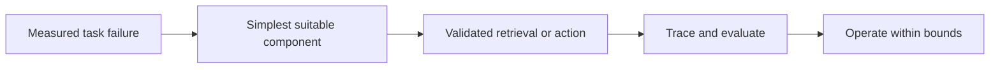

# Why AI systems grow from prompts into retrieval and stateful tools

[Subject home](../README.md) · [Foundation course](README.md) · [Practicals](../02-practicals/README.md)

These are system patterns as well as algorithms. Add a component only when a measured failure justifies it; a larger agent loop is not the final stage of every application.

## Read the motivation, mechanism and trade-off together

| Family / transition | Limitation or question | How the method works | What remains / why another branch matters | Read |
|---|---|---|---|---|
| Rules → language model classification/extraction | Free-form language is difficult to cover with fixed rules. | Use a model for interpretation and enforce schema/business constraints in code. | Plausible structured values can still be false. | [Lesson](lesson-01-llm-system-design.md) |
| Prompt-only → few-shot / structured contracts | Ambiguous instructions produce inconsistent formats/decisions. | Supply representative examples and a validated output contract. | Examples can bias results; syntax control is not factual grounding. | [Lesson](lesson-02-prompt-contracts.md) |
| Keyword → dense / hybrid retrieval | Exact matching can miss paraphrases; dense similarity can miss IDs. | Combine lexical and learned-vector signals, then optionally rerank candidates. | Metric, embedding version, filters and relevant-document evaluation matter. | [Lesson](lesson-03-embeddings-and-vector-search.md) |
| All-pairs exact search → ANN indexes | Large vector sets make exhaustive comparisons expensive. | Use graph/partition/quantization search structures under tunable recall/cost trade-offs. | Approximation and metadata filters can reduce relevant recall. | [Lesson](lesson-03-embeddings-and-vector-search.md) |
| Unassisted generation → RAG | A model may lack current/private evidence. | Retrieve eligible passages, assemble context and generate with support checks. | Missing/wrong evidence and incorrect citation use remain distinct failures. | [Lesson](lesson-04-rag-pipeline.md) |
| Single retrieval → query decomposition / reranking / iterative retrieval | Complex questions can require several pieces of evidence. | Split/search/refine under a bounded protocol and evaluate each stage. | More retrieval can amplify noise, cost or unauthorized context. | [Lesson](lesson-04-rag-pipeline.md) |
| Text-only output → tool calling / MCP connections | An answer alone cannot perform validated external operations. | Propose typed calls; the host validates identity, authority and arguments before execution. | A proposed call is not permission; retries can duplicate effects. | [Lesson](lesson-05-tools-and-mcp.md) |
| Fixed chain → state graph / bounded agent | Some tasks require conditional routing or dynamic choices. | Use explicit state/transitions or a controlled model-action loop. | Checkpointing does not make external writes idempotent or safe. | [Lesson](lesson-06-langchain-and-langgraph.md) |
| Ad hoc prompts → evaluations / operations / spec-driven development | One successful demo does not establish reliable behaviour. | Version task contracts, regression cases, traces and release criteria. | A benchmark or judge score can miss real-user failures; inspect concrete outcomes. | [Lesson](lesson-09-spec-driven-coding.md) |

## How to compare alternatives

Use the same task, eligible data, split/horizon and compute budget. State the objective, assumptions, training/update procedure, important settings and failure cases. A newer publication can address one bottleneck while being worse on another. A survey row identifies a family; it does not pretend to derive every research variant.

For a method you study, complete this sentence: “I would consider it because ___; it works by ___; I would compare it with ___ using ___; I would avoid or investigate it when ___.” Recalculate the worked examples before selecting by a method name.
