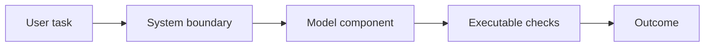

# 01 — LLM capabilities, system boundaries and task design

[Course map](README.md) · [Practicals](../02-practicals/README.md) · [Questions](../03-questions-and-answers/worked-questions.md#lesson-01)

## On this page

- [The idea](#the-idea)
- [Work through it](#work-through-it)
- [Common mistakes and practical limits](#common-mistakes-and-practical-limits)

## The idea

**Analogy:** An LLM is one component in a service, like an engine in a vehicle—not the steering, brakes and road rules.

Define the user task, expected output, allowed data/actions, latency/cost budget and failure consequences before selecting a model or framework. A deterministic rule may be better for exact validation; a language model can help interpret language, synthesize context or propose structured actions. Keep business constraints in application code where correctness must be enforced.

Tokens are model-specific units, not necessarily words. A context window limits the input/output that can be considered; it does not guarantee faithful use of all supplied content. Model randomness settings can influence variation but do not turn generation into a correctness proof. Structured output constrains form; the values can still be false.

Separate instructions, user input, retrieved content and tool results. External content is data, not authority to change the task. A reliable system has explicit input validation, bounded execution, logging with appropriate redaction, evaluation and a fallback. Start with the simplest workflow that solves the task before adding an autonomous loop.

## Work through it

For expense categorization, define allowed categories, required fields and an “uncertain” outcome. A generated JSON object{category:"travel",amount:200}must still pass schema/type checks and any source-reconciliation rule. A valid category string is not proof the receipt was interpreted correctly.

## Common mistakes and practical limits

Do not send all available private data merely because it fits the context. Avoid assuming a model's confident wording is calibrated. Provider API details change; keep code pinned and consult the corresponding official documentation.

---

[Subject home](../README.md) · [Prompt design, examples, schemas and failure handling →](lesson-02-prompt-contracts.md)
