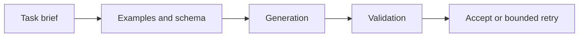

# 02 — Prompt design, examples, schemas and failure handling

[Course map](README.md) · [Practicals](../02-practicals/README.md) · [Questions](../03-questions-and-answers/worked-questions.md#lesson-02)

## On this page

- [The idea](#the-idea)
- [Work through it](#work-through-it)
- [Common mistakes and practical limits](#common-mistakes-and-practical-limits)

## The idea

**Analogy:** A good prompt is a clear task brief with an acceptance test, not a collection of magic phrases.

State the goal, relevant context, output contract and constraints. Include a small representative example when it clarifies ambiguity. Define how to handle missing evidence, conflicting inputs and unsupported requests. Prefer specific expected behaviour over vague instructions such as “be intelligent”.

Few-shot examples can teach format and distinctions, but can also bias outputs toward their labels or assumptions. Evaluate edge cases and out-of-distribution inputs. Keep prompts versioned alongside evaluation cases. A change that fixes one example can regress another.

For structured results, parse and validate with a schema, then apply domain checks. Distinguish recoverable invalid output from a genuinely unavailable answer. Bounded retries can request correction, but repeated generation is not guaranteed to fix an error. For consequential actions, let validated application logic decide whether to execute.

## Work through it

Task contract: given a receipt excerpt, return{merchant,total,currency,evidence}. If currency is absent, return null rather than guessing. Validation checks numeric nonnegative total, allowed currency format and that the evidence quote actually occurs in the source. Those checks catch different failure types.

An evaluation case with “subtotal 100,tax 10,total 110”should require total 110, not the first number 100.

## Common mistakes and practical limits

Examples must not contain secrets. Quoted text can include hostile instructions; delimiters help organization but are not a security boundary by themselves. Do not hide invalid outputs by silently filling defaults that look factual.

---

[← LLM capabilities, system boundaries and task design](lesson-01-llm-system-design.md) · [Embeddings, vector databases, similarity and hybrid search →](lesson-03-embeddings-and-vector-search.md)
