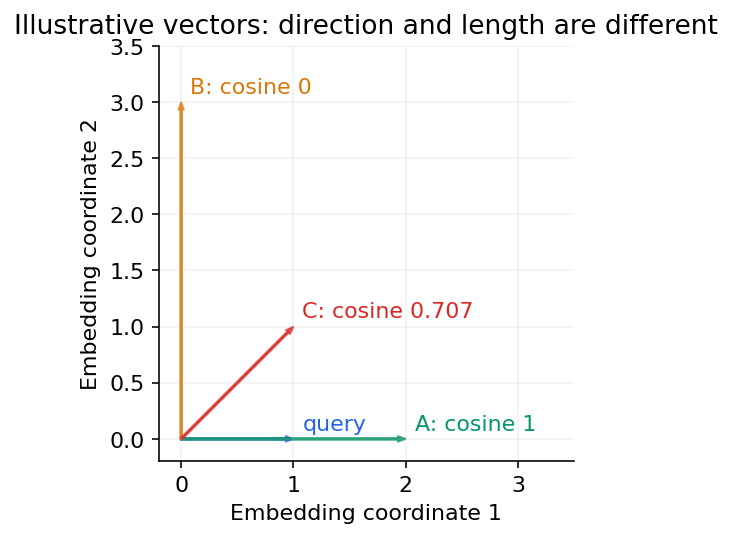

# 03 — Embeddings, vector databases, similarity and hybrid search

[Course map](README.md) · [Practicals](../02-practicals/README.md) · [Questions](../03-questions-and-answers/worked-questions.md#lesson-03)

Direction and magnitude affect similarity differently. See the worked example for its assumptions.

## On this page

- [The idea](#the-idea)
- [Work through it](#work-through-it)
- [Common mistakes and practical limits](#common-mistakes-and-practical-limits)

## The idea

**Analogy:** An embedding is a coordinate system for similarity, not a database of verified facts.

An embedding maps an item into a vector learned for a particular training objective. Cosine, inner product and Euclidean distances have different scale assumptions. Normalize deliberately and use a compatible metric. Mixing embeddings from different models/versions can invalidate comparisons.

A vector store adds retrieval, metadata and indexing around vectors. Exact search compares against every item; approximate-nearest-neighbour methods such as HNSW or partition/quantization families trade recall, memory, latency and update behaviour. Measure retrieval recall against a suitable exact/reference result rather than assuming faster search is equally accurate.

Keyword search handles exact terms/IDs well; semantic search handles paraphrase under its representation; hybrid retrieval combines signals. Reranking scores a smaller candidate set more carefully. Permissions and metadata filters must be enforced before unauthorized content can influence an answer, not merely hidden in the final display.

## Work through it

For query vector(1,0), documentA(2,0) has cosine 1 andB(0,3) has cosine 0. Raw inner products 2 and 0 rank them similarly here, but vector norms can change other rankings.

If an approximate index returns 8 of the 10 exact top candidates, recall@10=.8 for that query under the defined reference. Average over realistic queries, filters and update patterns.

## Common mistakes and practical limits

A near vector can contain obsolete or incorrect text. Chunk metadata must retain provenance and access rights. An embedding dimension count alone does not determine task quality.

---

[← Prompt design, examples, schemas and failure handling](lesson-02-prompt-contracts.md) · [RAG ingestion, chunking, retrieval, reranking and grounded answers →](lesson-04-rag-pipeline.md)
