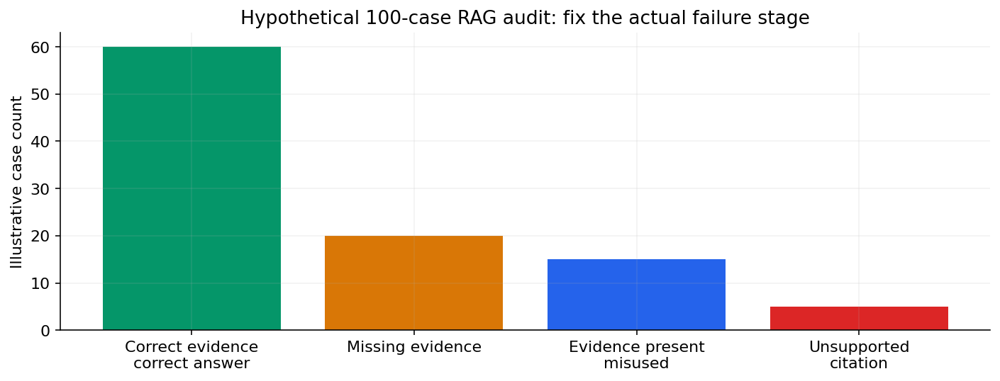

# 04 — RAG ingestion, chunking, retrieval, reranking and grounded answers

[Course map](README.md) · [Practicals](../02-practicals/README.md) · [Questions](../03-questions-and-answers/worked-questions.md#lesson-04)

Retrieval and answer failures need separate evaluation. See the worked example for its assumptions.

## On this page

- [The idea](#the-idea)
- [Work through it](#work-through-it)
- [Common mistakes and practical limits](#common-mistakes-and-practical-limits)

## The idea

**Analogy:** RAG resembles an open-book exam: finding the right page and using it correctly are separate skills.

Ingestion extracts usable content, preserves document identity/version/permissions, segments it and builds searchable representations. Chunk boundaries should preserve useful meaning and context, not merely satisfy a fixed character count. Tables, headings and scanned pages need extraction quality checks. Overlap can help continuity but creates duplicate evidence and extra cost.

At query time, optionally rewrite/decompose the query, retrieve candidates, filter by eligibility, rerank and provide selected evidence to a generator. The answer should cite actually supporting passages and admit when evidence is insufficient. Context assembly needs a budget and deduplication.

Evaluate retrieval and generation separately. Retrieval metrics need relevant-document judgements; answer evaluation checks correctness, citation support, coverage and abstention. Test unanswerable questions, stale/conflicting documents, misleading near matches and permission boundaries. More retrieved chunks can introduce distractions rather than improve answers.

## Work through it

A policy asks“how many leave days?”. RetrievedAis 2024 policy 20 days;Bis 2026 policy 24 days. The system must resolve version/applicability before generating a number. Returning 20 with a real citation is still wrong for a 2026 employee covered byB.

If the right document was never retrieved, improving the answer prompt alone may not solve the main failure.

## Common mistakes and practical limits

Do not cite a passage just because it shares keywords. OCR errors can alter numbers. Access control belongs throughout ingestion/retrieval/caching and not only in a prompt telling a model to be careful.

---

[← Embeddings, vector databases, similarity and hybrid search](lesson-03-embeddings-and-vector-search.md) · [Tool calling, schemas, MCP and authorization →](lesson-05-tools-and-mcp.md)
