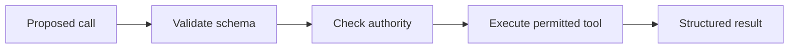

# 05 — Tool calling, schemas, MCP and authorization

[Course map](README.md) · [Practicals](../02-practicals/README.md) · [Questions](../03-questions-and-answers/worked-questions.md#lesson-05)

## On this page

- [The idea](#the-idea)
- [Work through it](#work-through-it)
- [Common mistakes and practical limits](#common-mistakes-and-practical-limits)

## The idea

**Analogy:** A tool is a doorway to a capability; a schema describes the door, while authorization controls who may enter.

A tool call contains a tool name and arguments under a defined schema. The host validates them and executes permitted operations, then returns a result. The model's proposal is not itself permission. Separate read-only lookup from actions such as sending, deleting or purchasing, and enforce the required authorization in host logic.

MCP standardizes selected connections between AI hosts/clients and servers exposing capabilities such as tools/resources. It does not automatically make a server trusted, grant access to every account or replace application authorization. Understand the configured transport, identity, scopes and data boundaries from the current specification.

Tool execution needs timeouts, bounded retries, idempotency for repeatable writes, structured errors and observability. Tool output may contain untrusted text; do not promote it into a higher-priority instruction. Prevent a retrieval result from instructing the system to export secrets or call unrelated tools.

## Work through it

A lookup tool accepts{customer_id:42}. Validate that the ID belongs to the authenticated user's accessible records before querying. A send-invoice tool additionally needs a verified recipient, approved content and an idempotency key. Retrying after a timeout without knowing whether the send succeeded can create duplicates.

## Common mistakes and practical limits

Do not expose unrestricted shell/SQL execution merely because it is convenient. A JSON schema checks shape, not business authority. Avoid logging credentials in tool arguments or traces.

---

[← RAG ingestion, chunking, retrieval, reranking and grounded answers](lesson-04-rag-pipeline.md) · [LangChain components, LangGraph state and durable workflows →](lesson-06-langchain-and-langgraph.md)
