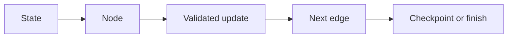

# 06 — LangChain components, LangGraph state and durable workflows

[Course map](README.md) · [Practicals](../02-practicals/README.md) · [Questions](../03-questions-and-answers/worked-questions.md#lesson-06)

## On this page

- [The idea](#the-idea)
- [Work through it](#work-through-it)
- [Common mistakes and practical limits](#common-mistakes-and-practical-limits)

## The idea

**Analogy:** A chain is a recipe; a state graph is a route map with explicit branches and checkpoints.

LangChain offers abstractions/integrations around models, tools and agent workflows. LangGraph focuses on stateful orchestration with explicit nodes, edges and persistence concepts. The framework names are not an architecture: specify the state, transitions, side effects and stopping condition yourself. Official APIs change, so use the linked current guides and pin examples to the installed version.

State contains the information needed to resume or route work. Nodes transform state or request capabilities; edges express the next step/branch. Reducers define how concurrent/partial updates combine. Checkpoints support recovery, but external actions must still be made safe against replay. A persisted transcript is not automatically trustworthy long-term memory.

Use deterministic nodes for validation and calculations, model nodes where language reasoning is useful, and explicit interrupts/review points for consequential actions. Bound loops by steps, elapsed time and budget. Record intermediate outcomes so a failure can be diagnosed rather than hidden in a single final response.

## Work through it

Expense workflow: extract receipt→validate fields→if missing, request clarification→categorize→calculate totals in code→review→store. State includes receipt ID, parsed fields, validation errors and completion status. A failed store retried after resume must not create a second receipt record.

## Common mistakes and practical limits

Do not put every operation into an agent when a function is enough. Checkpoint replay can duplicate side effects without idempotency. Memory needs retention, relevance and privacy rules, not unlimited accumulation.

---

[← Tool calling, schemas, MCP and authorization](lesson-05-tools-and-mcp.md) · [Agents, planning, memory, evaluation and failure analysis →](lesson-07-agent-evaluations.md)
