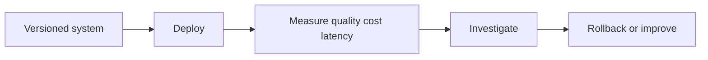
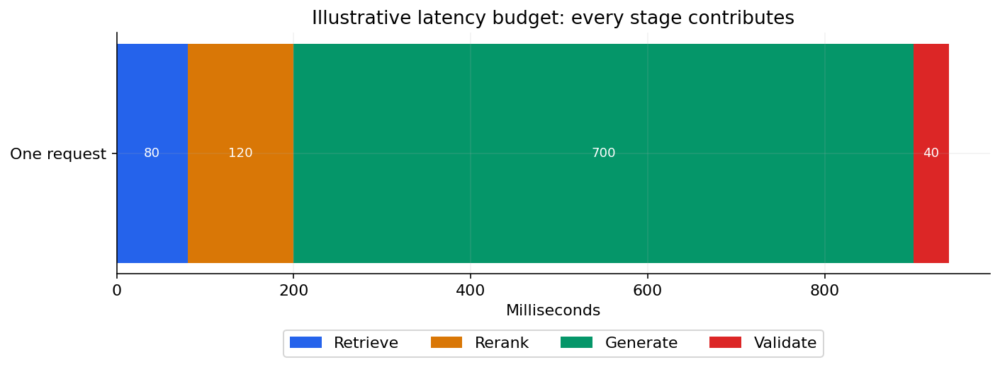

# 08 — LLMOps, caching, cost, deployment and security

[Course map](README.md) · [Practicals](../02-practicals/README.md) · [Questions](../03-questions-and-answers/worked-questions.md#lesson-08)

End-to-end latency includes every stage, not only generation. See the worked example for its assumptions.

## On this page

- [The idea](#the-idea)
- [Work through it](#work-through-it)
- [Common mistakes and practical limits](#common-mistakes-and-practical-limits)

## The idea

**Analogy:** Reliable AI operations resemble quality control on an assembly line, with checks at every handoff.

Version the model identifier/configuration, prompt, retrieval index, corpus and tools together. A model change or document update can alter behaviour without any application-code change. Use development, evaluation and production separation, regression cases and a rollback path.

Measure end-to-end latency by stage and tail, not only average model time. Cache only where identity, permissions, freshness and input equivalence make reuse valid. Semantic caches can return a near-match answer that is wrong for a changed date or user. Apply TTL/invalidation and avoid crossing tenant boundaries.

Track token usage and tool costs under realistic workloads. Bounded concurrency, timeouts, rate-limit handling and backoff protect availability. Security needs least privilege, secret handling, prompt-injection resistance, tool allowlists and output validation. Filtering a few dangerous phrases is not a complete security boundary. Preserve the option to abstain or fall back to a deterministic service.

## Work through it

If a request uses 2000 input and 500 output tokens, compute cost using the actual applicable provider rates, not a stale number in these notes. Add embedding, retrieval/reranker and tool costs where relevant. A cache key for policy answers should consider policy version and user eligibility rather than query text alone.

## Common mistakes and practical limits

Do not claim a system is secure because one jailbreak failed. Do not store raw sensitive prompts in unrestricted logs. A successful infrastructure health check does not prove answer quality.

---

[← Agents, planning, memory, evaluation and failure analysis](lesson-07-agent-evaluations.md) · [Spec-driven development, Claude Code, Copilot and reusable skills →](lesson-09-spec-driven-coding.md)
