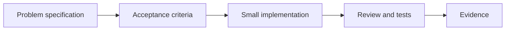

# 09 — Spec-driven development, Claude Code, Copilot and reusable skills

[Course map](README.md) · [Practicals](../02-practicals/README.md) · [Questions](../03-questions-and-answers/worked-questions.md#lesson-09)

## On this page

- [The idea](#the-idea)
- [Work through it](#work-through-it)
- [Common mistakes and practical limits](#common-mistakes-and-practical-limits)

## The idea

**Analogy:** A specification is a shared drawing of the finished product; a coding assistant helps build it but does not replace inspection.

Write a short problem statement, user flow, data model, constraints, acceptance criteria and explicit non-goals. Break the work into reviewable increments and turn important behaviours into tests or concrete manual checks. This is the learning goal behind building a project such as Spendly with an assistant: trace requirements into implementation and evidence.

Claude Code, Copilot and other coding assistants offer different surfaces and integrations, which evolve. Use official documentation for setup rather than copying obsolete commands. Give the assistant relevant repository context, a bounded task and expected checks. Inspect the resulting diff, run the application and verify behaviours; generated code is a proposal until reviewed.

Reusable skills/instructions package a recurring workflow and its supporting resources. Keep scope, inputs, outputs and verification clear. Distinguish project guidance from untrusted issue/document text. Do not place credentials in prompts or repository instructions. An assistant's ability to run a command is not permission to publish, delete or message externally.

## Work through it

Spendly acceptance example: entering a valid expense updates the monthly total once; an invalid negative amount is rejected; reloading preserves the saved record; editing changes the total correctly. A screenshot of the form is insufficient evidence for those behaviours.

A review checklist asks which requirement each changed file serves and what check demonstrates it. Preserve an error log of incorrect assumptions so later iterations improve the specification.

## Common mistakes and practical limits

Avoid asking for an entire application without a way to judge correctness. Do not accept passing tests that merely repeat a mistaken implementation. Keep deployment and destructive actions under the authorized scope.

---

[← LLMOps, caching, cost, deployment and security](lesson-08-llm-operations.md) · [Continue with practicals](../02-practicals/README.md)
