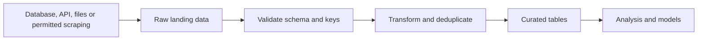
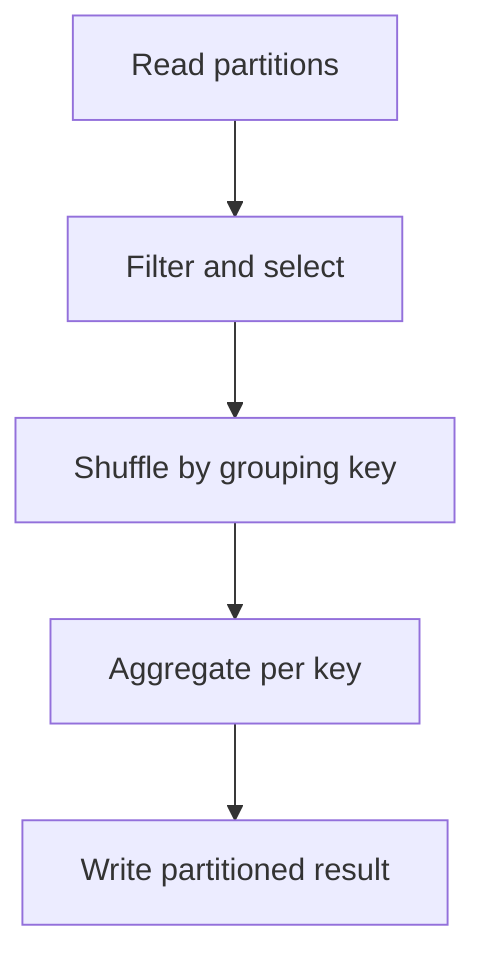

# Data engineering: reliable tables from messy inputs

[Subject home](../README.md) · [Theory index](README.md)

Data engineering makes data available, consistent and reproducible for analysis and models. A pipeline is useful only when the meaning of each row and its quality can be trusted.




## On this page

- [1. Define the data contract](#1-define-the-data-contract)
- [2. PySpark's execution model](#2-pysparks-execution-model)
- [3. Small practical example](#3-small-practical-example)
- [4. Storage, orchestration and scraping](#4-storage-orchestration-and-scraping)
- [5. A useful completion standard](#5-a-useful-completion-standard)

## 1. Define the data contract

Write the grain, primary/business keys, schema, units, timezone, update frequency and missing-value rules. A transaction date and an ingestion date answer different questions. Keep raw inputs so transformations can be rerun. A schema check catches a string where a number was expected; it cannot establish that an apparently valid number is correct.

For incrementally loaded orders, decide how updates, deletions, late arrivals and duplicate events are handled. An idempotent load gives the same final table when rerun with the same logical input. An append-only job without a deduplication key may double totals on retry.

## 2. PySpark's execution model

Spark distributes work across partitions. The driver plans/co-ordinates; executors process partitions. A DataFrame expresses a logical table transformation; many operations are lazy until an action requests a result. Selecting and filtering can remain local to partitions; joins, grouping and sorts often require shuffles across the network.



Prefer clear DataFrame expressions over unnecessary Python UDFs. Do not `collect()` a huge distributed table into driver memory merely to inspect it. Show a bounded sample and aggregate summaries instead. Cache only when reuse justifies memory/storage cost, and unpersist when appropriate.

## 3. Small practical example

```python
# Requires a working Spark installation/session; illustrative DataFrame example.
from pyspark.sql import SparkSession, functions as F
spark = SparkSession.builder.master("local[*]").appName("learning-hub").getOrCreate()
orders = spark.createDataFrame(
    [("East", 100), ("East", 200), ("West", 80)], ["region", "amount"]
)
summary = (orders.filter(F.col("amount") >= 0)
           .groupBy("region").agg(F.sum("amount").alias("revenue")))
summary.orderBy("region").show()
# East: 300, West: 80
```

Use explicit schemas for reliable file ingestion. Casting failures and nulls need a policy: quarantine invalid rows, report counts and avoid silently treating failed amounts as zero. Joins need cardinality checks, just as in SQL. A few skewed keys can put most work on one partition; inspect the plan and key distribution before changing partition counts.

The [Spark DataFrame guide](https://spark.apache.org/docs/latest/sql-getting-started.html) documents the relationship between DataFrame operations and SQL. The existing practicals cover reading data, types, missing values, filters, grouping and ML examples; their Databricks paths may need adaptation to your own environment.

## 4. Storage, orchestration and scraping

Columnar formats such as Parquet can avoid reading unused columns. Partitioning can improve relevant reads, but too many tiny files or very high-cardinality partition keys can hurt. Separate storage layout from a notebook's display ordering.

An orchestrator tracks dependencies, retries and schedules. A scheduled success status is not proof that the table passed quality checks. Record input/output row counts, unique-key checks, freshness and reconciliation totals. Distinguish transient infrastructure failures from data-quality failures that require inspection.

For scraping, first check whether a permitted API or dataset provides the information. Respect the site's access rules, rate limits and privacy constraints. Parse robustly, store provenance and avoid assuming that a page's layout never changes. The scraping notebooks are practical examples, not a guarantee that a historical target still exposes the same markup.

## 5. A useful completion standard

A new reader should know how the data was obtained, how a bad row is handled, whether rerunning duplicates it, when the table was last updated and how totals were checked. Train models only after the data pipeline's meaning and availability match the prediction task.


[Try the practicals](../02-practicals/README.md)
