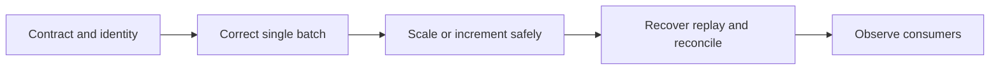

# How data-processing algorithms change as scale and failure modes grow

[Subject home](../README.md) · [Foundation course](README.md) · [Practicals](../02-practicals/README.md)

Correctness and failure semantics come before speed. Many data-engineering methods are execution/storage patterns rather than statistical estimators.

## Read the motivation, mechanism and trade-off together

| Family / transition | Limitation or question | How the method works | What remains / why another branch matters | Read |
|---|---|---|---|---|
| Full reload → incremental / CDC | Repeated complete scans can be costly and delay updates. | Track changes/checkpoints and explicit insert/update/delete semantics. | Late/corrected records can defeat simple timestamp cutoffs. | [Lesson](lesson-02-batch-and-incremental.md) |
| Append-only writes → dedup / idempotent upsert | At-least-once delivery can repeat effects. | Use stable identities and transactional state to reconcile replays. | Same ID with a different payload needs a defined correction/conflict rule. | [Lesson](lesson-02-batch-and-incremental.md) |
| Row text scans → columnar files / partition pruning | Analytic queries often need few columns and limited time ranges. | Store columns efficiently and eliminate irrelevant partitions/files under valid metadata. | Tiny files and high-cardinality partitions can worsen performance. | [Lesson](lesson-03-storage-and-models.md) |
| Single-node aggregation → map/combine/shuffle/reduce | One machine may not fit the work. | Partition input, preaggregate where valid, move keys and combine results. | Skew, network and nonassociative/approximate arithmetic complicate scaling. | [Lesson](lesson-04-spark-and-distributed-compute.md) |
| Large shuffle joins → broadcast / skew-aware strategies | Moving both sides can dominate runtime. | Replicate a truly small side or use an appropriate skew strategy. | Memory limits and output cardinality still apply. | [Lesson](lesson-04-spark-and-distributed-compute.md) |
| Batch windows → event-time stateful streaming | Results may be needed before the entire dataset exists. | Maintain window/state updates with defined lateness and recovery rules. | Watermarks bound selected handling; they do not prevent late data. | [Lesson](lesson-05-streaming-and-orchestration.md) |
| Repeated exact summaries → sketches / sampling | Huge distinct counts/quantiles may be expensive. | Use a suitable probabilistic sketch such as HLL-style distinct counting or a quantile sketch with stated guarantees. | Approximation error and merge assumptions must match the required decision. | [Lesson](lesson-06-observability-and-governance.md) |
| Scripts → DAG orchestration and data contracts | Uncoordinated jobs can publish inconsistent results. | Encode dependencies, validation gates, ownership and replay-safe tasks. | A green task exit is not proof of fresh correct data. | [Lesson](lesson-01-data-contracts.md) |

## How to compare alternatives

Use the same task, eligible data, split/horizon and compute budget. State the objective, assumptions, training/update procedure, important settings and failure cases. A newer publication can address one bottleneck while being worse on another. A survey row identifies a family; it does not pretend to derive every research variant.

For a method you study, complete this sentence: “I would consider it because ___; it works by ___; I would compare it with ___ using ___; I would avoid or investigate it when ___.” Recalculate the worked examples before selecting by a method name.
