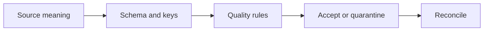

# 01 — Sources, grain, schema, contracts and data quality

[Course map](README.md) · [Practicals](../02-practicals/README.md) · [Questions](../03-questions-and-answers/worked-questions.md#lesson-01)

## On this page

- [The idea](#the-idea)
- [Work through it](#work-through-it)
- [Common mistakes and practical limits](#common-mistakes-and-practical-limits)

## The idea

**Analogy:** A pipeline is a delivery service: the parcel needs an identity, contents and delivery agreement.

A data contract defines field meaning, types, keys, allowed values, event timing, freshness and ownership. Schema alone is insufficient: a positive number can still have the wrong currency or unit. State whether a row is an event, current entity state or snapshot. Track source and ingestion timestamps separately.

Quality checks include completeness, uniqueness, referential integrity, valid ranges, freshness and reconciliation. Distinguish invalid records that must be quarantined from tolerable missingness with a defined downstream policy. A rejected record should retain a reason and source identifier so it can be corrected rather than disappearing silently.

Contracts change. Use explicit versioning and a compatibility policy; adding an optional field differs from changing an ID's meaning. Record lineage from source to transformations and outputs. This allows a wrong dashboard total to be traced to its source rather than patched manually at the end.

## Work through it

A contract for payments includes payment_id(unique), amount(nonnegative decimal), currency(required), event_time(aware timestamp) and source_version. The record amount 500 is incomplete if one producer means paise and another means rupees. Type checking alone cannot distinguish them.

Reconcile accepted_count+rejected_count=input_count, then reconcile accepted totals with the appropriate source window.

## Common mistakes and practical limits

Do not enforce uniqueness on a non-key merely because it repeats. A quality threshold needs an owner and response plan. An undocumented default can convert missing data into fabricated facts.

---

[Subject home](../README.md) · [Batch ingestion, CDC, watermarks and idempotency →](lesson-02-batch-and-incremental.md)
