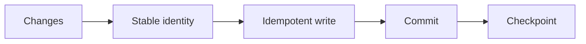
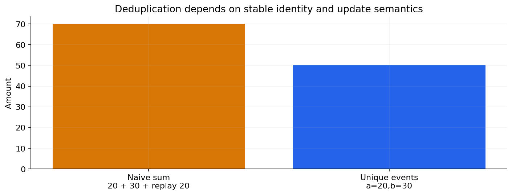

# 02 — Batch ingestion, CDC, watermarks and idempotency

[Course map](README.md) · [Practicals](../02-practicals/README.md) · [Questions](../03-questions-and-answers/worked-questions.md#lesson-02)

Stable event identity prevents repeated events inflating totals. See the worked example for its assumptions.

## On this page

- [The idea](#the-idea)
- [Work through it](#work-through-it)
- [Common mistakes and practical limits](#common-mistakes-and-practical-limits)

## The idea

**Analogy:** Incremental processing is updating a ledger from new evidence without counting yesterday twice.

Batch ingestion handles a bounded set; incremental ingestion processes changes since a checkpoint. A high-water mark can use a source timestamp or sequence, but late arrivals and updates make a naive “greater than last timestamp”rule fragile. CDC captures source changes with operation/order semantics; deletions must be represented too.

Idempotency means repeating the same intended input yields the same intended final state rather than duplicated effects. Use stable event/business keys, transactional upserts or a deduplication ledger. Checkpoint only when the corresponding output commit is safely accounted for. A crash between output write and checkpoint update is a classic duplicate/replay boundary.

Backfills rerun historical windows under versioned logic. Keep them isolated or coordinated with live ingestion and handle corrections deliberately. At-least-once delivery plus idempotent sinks can provide useful effective behaviour; an “exactly once”claim needs a specified boundary, source, sink and failure model.

## Work through it

Events[id=a,amount 20],[id=b,amount 30],[id=a,amount 20]should yield two unique business events totaling 50 under a stable-ID dedup rule, not 70. If a later event reusesa with corrected amount 25, decide whether it is an update, versioned event or invalid conflict before deduplicating.

## Common mistakes and practical limits

A timestamp alone may not be unique. Never overwrite a checkpoint ahead of committed output. Treating every repeated ID as identical can erase legitimate corrections.

---

[← Sources, grain, schema, contracts and data quality](lesson-01-data-contracts.md) · [Files, partitions, warehouses, lakes and dimensional models →](lesson-03-storage-and-models.md)
