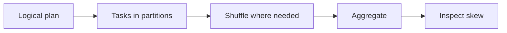
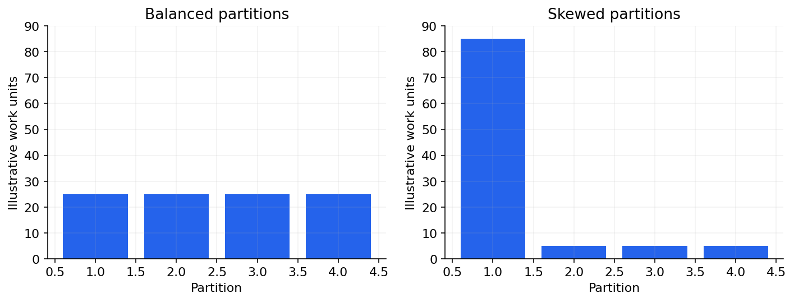

# 04 — PySpark, lazy plans, partitions, joins and shuffles

[Course map](README.md) · [Practicals](../02-practicals/README.md) · [Questions](../03-questions-and-answers/worked-questions.md#lesson-04)

One overloaded partition can dominate a distributed stage. See the worked example for its assumptions.

## On this page

- [The idea](#the-idea)
- [Work through it](#work-through-it)
- [Common mistakes and practical limits](#common-mistakes-and-practical-limits)

## The idea

**Analogy:** Distributed computation divides work among kitchens; a shuffle redistributes ingredients between them.

A Spark DataFrame represents a structured distributed computation. Transformations build a plan; actions trigger execution. Lazy evaluation lets the engine optimize a plan, but repeated actions can recompute expensive steps unless materialization/caching is justified. Inspect explain plans and actual stage metrics.

Partitions define parallel work units. Narrow operations can work within partitions; shuffles redistribute data for operations such as many joins/aggregations. Skew means one key or partition dominates work and becomes a bottleneck. Broadcast joins can avoid shuffling a large side when a genuinely small side can fit under the configured strategy.

Prefer built-in expressions over unnecessary Python UDFs where they support the operation and preserve semantics, because they often enable better optimization/execution. Avoid collecting a large dataset to the driver. Caching consumes memory and needs a reuse justification; more caching is not automatically faster.

## Work through it

A customer with 90% of all events can dominate a group-by stage even if there are many workers. Repartitioning randomly may not fix a later grouping that sends that key's data back together. Consider preaggregation or an appropriate skew strategy while preserving exact results.

A small customer dimension joined to a huge event fact may be a broadcast candidate; “small”must be measured relative to actual executor resources.

## Common mistakes and practical limits

Do not infer speed from worker count alone. `collect()`can exhaust driver memory. Physical partitioning, file layout and logical table partitions are related but distinct concepts.

---

[← Files, partitions, warehouses, lakes and dimensional models](lesson-03-storage-and-models.md) · [Streams, event time, windows, retries and DAG orchestration →](lesson-05-streaming-and-orchestration.md)
