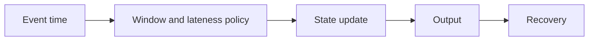

# 05 — Streams, event time, windows, retries and DAG orchestration

[Course map](README.md) · [Practicals](../02-practicals/README.md) · [Questions](../03-questions-and-answers/worked-questions.md#lesson-05)

## On this page

- [The idea](#the-idea)
- [Work through it](#work-through-it)
- [Common mistakes and practical limits](#common-mistakes-and-practical-limits)

## The idea

**Analogy:** A stream is a continuously arriving conversation; an orchestrator makes sure dependent work happens in the right order.

Streaming systems process unbounded arrivals under defined state and delivery semantics. Event time describes when something happened; processing time describes when computation sees it. Windows group events over time. Watermarks estimate progress and bound selected late-data/state handling; they do not make late events impossible.

An orchestration DAG records task dependencies and scheduling/retry rules. A successful task must have produced valid output, not merely exited 0. Separate transient failures suitable for retries from invalid-input failures needing intervention. Define timeouts, backoff, data intervals and idempotent outputs.

Reprocessing, checkpoint recovery and backfills must produce reconciled results under the same logic/version policy. Monitor lag, late arrivals, state size, job duration, output freshness and rejected records. A green scheduler status is not proof a dashboard contains today's correct data.

## Work through it

A10:05 event arrives at 10:20. An event-time 10:00–10:10 window may need updating if the configured lateness policy permits it; a processing-time window may place it elsewhere. Choose the policy from the business question.

Pipeline dependency: extract→validate→transform→reconcile→publish. A failed reconciliation should block publication rather than retrying the publish task on bad data.

## Common mistakes and practical limits

Retries without idempotency can duplicate outputs. Do not let a watermark policy silently discard important corrections without an audit path. A schedule timestamp is not necessarily the data interval being processed.

---

[← PySpark, lazy plans, partitions, joins and shuffles](lesson-04-spark-and-distributed-compute.md) · [Lineage, observability, access, retention and cost →](lesson-06-observability-and-governance.md)
