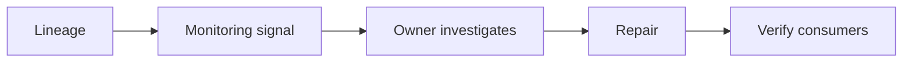

# 06 — Lineage, observability, access, retention and cost

[Course map](README.md) · [Practicals](../02-practicals/README.md) · [Questions](../03-questions-and-answers/worked-questions.md#lesson-06)

## On this page

- [The idea](#the-idea)
- [Work through it](#work-through-it)
- [Common mistakes and practical limits](#common-mistakes-and-practical-limits)

## The idea

**Analogy:** A reliable data platform needs a map of where records came from and who may use them.

Lineage links outputs to sources and transformations. Observability tracks volume, freshness, schema, distribution and business invariants. An alert should identify ownership and an actionable response; otherwise a growing alert list becomes background noise. Establish service expectations appropriate to consumers and measure breaches.

Access control follows least privilege, with separation for raw sensitive records and curated aggregates. Masking, aggregation and pseudonymization have different guarantees; a hashed identifier is not necessarily anonymous. Retention and deletion must account for backups, caches, derived datasets and downstream copies under the applicable requirements.

Cost comes from storage, scans, shuffles, retained versions, orchestration and operational effort. Measure before tuning. Use partition pruning, selected columns, sensible file sizes and incremental processing where they preserve correctness. A cheaper pipeline that silently loses events is not an improvement.

## Work through it

If daily revenue drops 40% while input count is stable, inspect currency, refunds, duplicate handling, price fields and source coverage. If input count also drops, investigate ingestion/freshness first. Lineage narrows which upstream change could explain the affected output.

A report shared with a partner should expose only the authorized aggregate, not a hidden raw-data sheet containing all customer records.

## Common mistakes and practical limits

Do not log unrestricted personal records merely to improve debugging. Data quality and access controls must cover derived outputs too. Cost reduction needs a correctness/performance comparison, not only a lower invoice.

---

[← Streams, event time, windows, retries and DAG orchestration](lesson-05-streaming-and-orchestration.md) · [Continue with practicals](../02-practicals/README.md)
