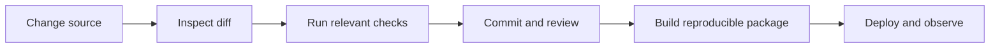
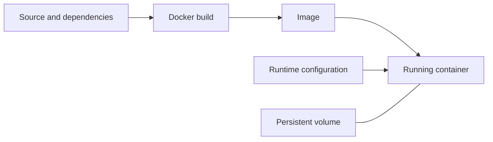

# Git, Docker and deployment: make work reproducible

[Subject home](../README.md) · [Theory index](README.md)

A notebook that runs once is a useful experiment. A maintained application also needs a versioned source, a reproducible environment, a documented entry point and checks on its behaviour after deployment.

## On this page

- [1. Git: understand the three places](#1-git-understand-the-three-places)
- [2. Reproducible Python application](#2-reproducible-python-application)
- [3. Docker: image versus container](#3-docker-image-versus-container)
- [4. Streamlit and service boundaries](#4-streamlit-and-service-boundaries)
- [5. Deploy, observe and recover](#5-deploy-observe-and-recover)

## 1. Git: understand the three places

The working tree holds files you edit; the staging area selects the next snapshot; the repository history stores commits. `git status` shows the state, `git diff` shows unstaged changes and `git diff --staged` shows the next commit's content. `git add` stages a file; `git commit` records it. A branch is a movable name for a line of history, not another complete copy of every file.

A practical workflow is fetch, create a focused branch, edit, inspect/test, commit, push and review a pull request. Merge after the result is ready; delete the merged review branch when it is no longer needed. Avoid rewriting shared history casually. Use `git restore` or reset commands only after understanding which uncommitted changes they discard. Keep credentials, datasets with restrictions, environments and generated caches out of commits.

## 2. Reproducible Python application

Document how to create an environment, install dependencies and start the program. Store dependency versions used for the tested result. Keep configuration separate from secrets. An environment variable can supply a secret at runtime; it should not be printed or embedded into a committed image.

Separate data cleaning and prediction functions from a web UI so they can be checked independently. Use the same preprocessing at training and inference. Loading model files from untrusted sources can be dangerous, especially executable serialization formats.

## 3. Docker: image versus container

An image is a packaged filesystem and configuration; a container is a running instance of it. A Dockerfile describes build steps. Put stable dependency steps before frequently changed source steps to reuse caching. A `.dockerignore` excludes irrelevant local files from the build context. Ports connect a containerized service to callers; volumes persist data outside a disposable container filesystem.

Use a suitable maintained base image, install only needed packages and run with appropriate privileges. Do not confuse a successful build with a passing application check. The existing hello-world application and Dockerfile are the first practicals to inspect before containerizing a model.

## 4. Streamlit and service boundaries

Streamlit builds a data application around Python execution and interactive controls. A change to a widget can rerun application logic, so keep expensive computation and side effects intentional. A prediction button should not retrain a model on every click. Validate user inputs and display useful errors rather than raw stack traces with internal information.

An API separates a client from prediction/service logic. Specify request types, expected response, error handling and model version. A browser interface and an API endpoint can share the same tested prediction function.

## 5. Deploy, observe and recover

Before release, check the entry command, required files, dependency/environment setup, health response and one representative end-to-end request. Monitor service availability, latency, error rate and data/model quality. Data drift describes changes in inputs; it does not by itself prove that predictive quality has fallen. Collect appropriate outcome feedback when available.

Keep the previous working release and a rollback procedure. Record what changed in code, configuration, model and data. The cloud-deployment documents retain historical examples; provider interfaces and commands may need checking against their current documentation before execution.

[Try the practicals](../02-practicals/README.md)
