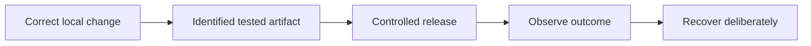

# From local code to reproducible and recoverable systems

[Subject home](../README.md) · [Foundation course](README.md) · [Practicals](../02-practicals/README.md)

The progression here concerns engineering mechanisms. Deployment tools do not replace algorithm correctness, and a more complex platform is not inherently a better system.

## Read the motivation, mechanism and trade-off together

| Family / transition | Limitation or question | How the method works | What remains / why another branch matters | Read |
|---|---|---|---|---|
| Untracked edits → content-addressed commits / version DAG | Manual copies lose provenance and coherent change history. | Git records snapshots with parent relationships and movable branch references. | A commit is not a remote backup until safely replicated. | [Lesson](lesson-01-git-mental-model.md) |
| Independent changes → three-way merge / rebase | Collaboration creates diverging histories. | Integrate changes relative to a base or replay commits onto a new base. | Textual success does not establish compatible behaviour; rebase rewrites identities. | [Lesson](lesson-02-collaboration-and-recovery.md) |
| Machine-specific setup → packaged environment / container | Different runtimes/dependencies cause inconsistent execution. | Build an identified image and supply explicit runtime configuration/state. | A successful build does not test the running service or guarantee isolation. | [Lesson](lesson-03-docker-and-environments.md) |
| Single request processing → queue / retry / backoff / circuit breaker | Bursts/transient failures can overwhelm a dependency. | Buffer work, bound retries, delay retries and stop repeated failing calls under a policy. | Writes need idempotency and error classification; retry storms can amplify outages. | [Lesson](lesson-04-apis-and-applications.md) |
| Big-bang release → canary / blue-green / rollback | Unverified changes expose every user at once. | Promote a tested artifact under measured gates and a recovery plan. | Database changes and external effects may not roll back with application code. | [Lesson](lesson-05-ci-cd-and-releases.md) |
| Single service → replication / distributed coordination | Availability/scale can require multiple copies and leaders. | Use an appropriate replicated-state/coordination system with explicit consistency/failure assumptions. | Consensus/replication do not remove partitions or make every operation instantly consistent; use established implementations. | [Lesson](lesson-06-production-operations.md) |

## How to compare alternatives

Use the same task, eligible data, split/horizon and compute budget. State the objective, assumptions, training/update procedure, important settings and failure cases. A newer publication can address one bottleneck while being worse on another. A survey row identifies a family; it does not pretend to derive every research variant.

For a method you study, complete this sentence: “I would consider it because ___; it works by ___; I would compare it with ___ using ___; I would avoid or investigate it when ___.” Recalculate the worked examples before selecting by a method name.
