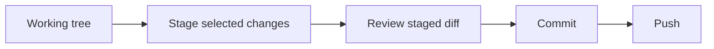

# 01 — Git working tree, staging, commits, branches and history

[Course map](README.md) · [Practicals](../02-practicals/README.md) · [Questions](../03-questions-and-answers/worked-questions.md#lesson-01)

## On this page

- [The idea](#the-idea)
- [Work through it](#work-through-it)
- [Common mistakes and practical limits](#common-mistakes-and-practical-limits)

## The idea

**Analogy:** Git snapshots a chosen set of changes; the staging area is the packing table before the parcel is sealed.

The working tree is the checked-out files, the index/staging area selects the next snapshot and a commit records a snapshot plus parent/history metadata. A branch is a movable reference to a commit; HEAD identifies the current checkout context. An untracked file is not saved in Git merely because it is visible in an editor.

Use status and diff to understand changes, then inspect the staged diff before committing. A commit should have a coherent purpose and a message explaining the problem/result. Ignore generated caches, local environments and secrets deliberately. A tracked file is not removed from history just because a later ignore rule matches it.

Commits provide history, not a remote backup until pushed elsewhere. Inspect log and blame to understand why code changed, without treating an old change as proof it remains correct. Prefer small reviewable steps over a large unexplained snapshot.

## Work through it

A safe teaching sequence is `git status`, `git diff`, stage selected paths, `git diff --staged`, then commit. These notes do not run commands on your repositories automatically.

If you stage a file and then edit it again, the staged snapshot and working-tree version differ. The next commit contains the staged version, not necessarily what the editor currently shows.

## Common mistakes and practical limits

Do not stage secrets or unrelated changes. Destructive reset/clean operations can remove uncommitted work; understand their scope first. Git history is not a substitute for secure secret rotation after exposure.

---

[Subject home](../README.md) · [Remotes, pull requests, merges, rebases and conflict resolution →](lesson-02-collaboration-and-recovery.md)
