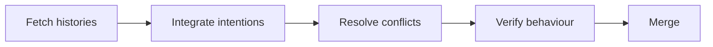

# 02 — Remotes, pull requests, merges, rebases and conflict resolution

[Course map](README.md) · [Practicals](../02-practicals/README.md) · [Questions](../03-questions-and-answers/worked-questions.md#lesson-02)

## On this page

- [The idea](#the-idea)
- [Work through it](#work-through-it)
- [Common mistakes and practical limits](#common-mistakes-and-practical-limits)

## The idea

**Analogy:** Collaboration joins two histories; a conflict asks a human to resolve incompatible intentions.

Fetch updates remote-tracking knowledge without automatically integrating changes into your current branch. Pull combines a fetch with an integration strategy. A merge joins histories; a rebase replays commits onto a different base and changes their identities. Avoid rewriting shared history without a coordinated policy.

A pull request communicates the problem, resulting behaviour and evidence for review. Resolve conflicts by understanding both changes, not simply choosing one side's text. Run relevant checks after integration because two individually correct changes can interact incorrectly. Delete a review branch after its changes are safely merged when that is the agreed workflow.

Recovery tools such as reflog can help locate previous reference states, but availability and retention are not a universal backup guarantee. Reverting creates a new inverse change; resetting moves a reference and may change working/index state depending on mode. Prefer deliberate operations whose effects you can explain.

## Work through it

Two branches modify the same validation function: one adds a required field, the other changes numeric parsing. A textual conflict resolution that keeps only one version may lose the other requirement. A correct resolution preserves both intended behaviours and verifies missing/invalid/valid cases.

## Common mistakes and practical limits

Do not force-push a shared branch casually. A conflict-free merge can still introduce a logical regression. Branch deletion should follow confirmation that the intended commits are present in the destination.

---

[← Git working tree, staging, commits, branches and history](lesson-01-git-mental-model.md) · [Docker images, containers, builds, volumes and configuration →](lesson-03-docker-and-environments.md)
