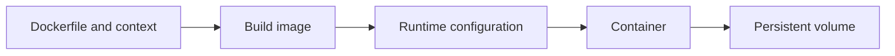

# 03 — Docker images, containers, builds, volumes and configuration

[Course map](README.md) · [Practicals](../02-practicals/README.md) · [Questions](../03-questions-and-answers/worked-questions.md#lesson-03)

## On this page

- [The idea](#the-idea)
- [Work through it](#work-through-it)
- [Common mistakes and practical limits](#common-mistakes-and-practical-limits)

## The idea

**Analogy:** An image is a packaged recipe and ingredients; a container is one running instance of that package.

An image contains filesystem layers and runtime configuration; a container runs it with isolated process/resource boundaries under the host platform. A Dockerfile declares build steps. Build context determines which files can be sent into the build; use a suitable ignore file and avoid including credentials/data accidentally.

Separate immutable application packaging from runtime configuration and persistent state. Environment variables are convenient configuration but not a complete secret-management solution. Volumes preserve selected state beyond a container's writable layer. Map ports deliberately; a process listening only on its loopback interface inside a container may not be reachable as expected.

Pin dependencies, minimize unnecessary build contents and run with appropriate nonroot privileges where possible. Layer ordering affects cache reuse. A successful build proves packaging completed, not that the endpoint starts, validates inputs or returns correct predictions. Test the running artifact under realistic resource constraints.

## Work through it

A model service needs application code, compatible dependencies and a versioned model artifact. A Docker image alone should not contain a developer's personal token. After starting it, test a valid request, invalid schema and oversized payload, plus restart behaviour for any intended persistent data.

## Common mistakes and practical limits

Container isolation is not an absolute security boundary. A volume mounted over an application directory can hide packaged files. Latest tags are moving references and do not guarantee reproducible deployment.

---

[← Remotes, pull requests, merges, rebases and conflict resolution](lesson-02-collaboration-and-recovery.md) · [APIs, schemas, errors, authentication and application design →](lesson-04-apis-and-applications.md)
