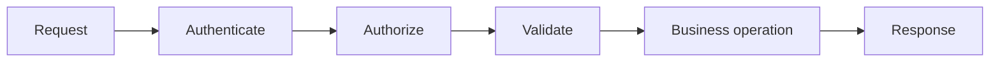

# 04 — APIs, schemas, errors, authentication and application design

[Course map](README.md) · [Practicals](../02-practicals/README.md) · [Questions](../03-questions-and-answers/worked-questions.md#lesson-04)

## On this page

- [The idea](#the-idea)
- [Work through it](#work-through-it)
- [Common mistakes and practical limits](#common-mistakes-and-practical-limits)

## The idea

**Analogy:** An API is a public contract: callers need predictable inputs, outputs and failures.

Define request/response schemas, units, status/error conventions and supported version behaviour. Validate types, sizes, ranges and authorization before computation or side effects. Authentication identifies a caller; authorization decides what that identity may do. A hidden UI button is not an access control.

Keep presentation, business logic and storage concerns separable. A dashboard/prototype framework can be appropriate for exploration, while multiuser production needs explicit concurrency, state, access and deployment design. A prediction endpoint must include the same preprocessing and class/feature order as training.

External calls require timeouts and bounded retries. Retry only when the action/error semantics permit it; writes may need idempotency keys. Do not leak stack traces, secrets or personal records in user-facing errors. Log enough context to diagnose with appropriate redaction and correlation IDs.

## Work through it

An expense endpoint accepts amount, currency and date. A response returning total 100 must define whether it is monthly, per user and in which currency. If a request times out after the database commit, blindly resending can duplicate the expense unless a stable request key is enforced.

## Common mistakes and practical limits

Do not trust a client-supplied user ID as proof of ownership. Input validation and authorization are separate checks. HTTP success does not establish that a numerical result is meaningful.

---

[← Docker images, containers, builds, volumes and configuration](lesson-03-docker-and-environments.md) · [CI/CD, quality gates, environments and release strategies →](lesson-05-ci-cd-and-releases.md)
