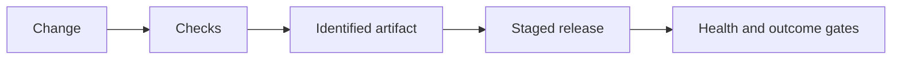
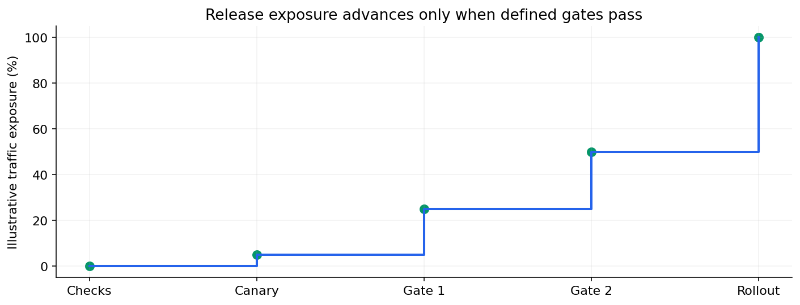

# 05 — CI/CD, quality gates, environments and release strategies

[Course map](README.md) · [Practicals](../02-practicals/README.md) · [Questions](../03-questions-and-answers/worked-questions.md#lesson-05)

A staged release increases exposure only after checks. See the worked example for its assumptions.

## On this page

- [The idea](#the-idea)
- [Work through it](#work-through-it)
- [Common mistakes and practical limits](#common-mistakes-and-practical-limits)

## The idea

**Analogy:** A release pipeline is a series of gates that check the actual package before it reaches users.

Continuous integration runs relevant checks on changes; continuous delivery/deployment automates selected release steps under a defined policy. Linting, unit/integration tests, dependency/security checks and artifact verification address different risks. A green badge only means configured checks passed.

Build one identifiable artifact and promote it through environments rather than rebuilding an untraceable “same”version each time. Keep environment-specific configuration outside the immutable artifact. Use scoped credentials and avoid exposing secrets to untrusted contributions.

A rolling, canary or blue/green release changes traffic exposure differently. Database migrations need compatibility with old/new application versions and recovery planning; rolling back application code does not necessarily undo a destructive schema change. Compare health, user outcomes and relevant model metrics after release, with clear stop/rollback criteria.

## Work through it

A canary serves 5% of eligible traffic while monitoring error rate and latency against the current version. If failures rise, route traffic back using the prepared mechanism. The 5% is illustrative: exposure and duration should follow workload, risk and sample-size considerations.

## Common mistakes and practical limits

Do not deploy a different artifact from the one tested without re-verification. A failed release can be a configuration or migration issue rather than a code bug. Rollback must be exercised, not merely mentioned in a README.

---

[← APIs, schemas, errors, authentication and application design](lesson-04-apis-and-applications.md) · [Monitoring, reliability, secrets and incident response →](lesson-06-production-operations.md)
