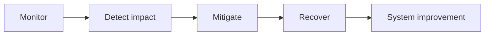
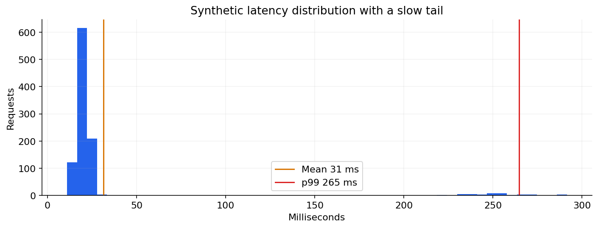

# 06 — Monitoring, reliability, secrets and incident response

[Course map](README.md) · [Practicals](../02-practicals/README.md) · [Questions](../03-questions-and-answers/worked-questions.md#lesson-06)

A good average can hide a slow request tail. See the worked example for its assumptions.

## On this page

- [The idea](#the-idea)
- [Work through it](#work-through-it)
- [Common mistakes and practical limits](#common-mistakes-and-practical-limits)

## The idea

**Analogy:** Operations keeps the promise after launch: detect failure, limit damage and recover with evidence.

Monitor availability, latency, errors, saturation and task-specific correctness. Distinguish infrastructure health from business/model health. Define an SLI measurement, an SLO target and the response when service quality falls below expectations. Tail latency can matter more than a reassuring average.

Use least-privilege credentials, rotation and controlled secret distribution. Backups need restoration tests and recovery objectives; a backup file that cannot be restored is not a recovery plan. Store sensitive logs under appropriate access and retention rules.

During an incident, establish impact, mitigate safely, preserve relevant evidence and communicate through the authorized process. Afterward identify contributing system causes, improve detection/prevention and assign concrete follow-up. Blaming one person or adding an alert without ownership does not improve reliability.

## Work through it

An endpoint returns 200 but always predicts the same class after a feature-order bug. Availability monitoring stays green; a representative prediction check and score-distribution monitor can expose the failure. Recovery involves the full preprocessing/model bundle, not merely restarting the web server.

## Common mistakes and practical limits

Avoid logging secrets “temporarily”. More alerts can worsen response if they are noisy/unowned. A successful restart does not prove lost data or incorrect outputs were repaired.

---

[← CI/CD, quality gates, environments and release strategies](lesson-05-ci-cd-and-releases.md) · [Continue with practicals](../02-practicals/README.md)
