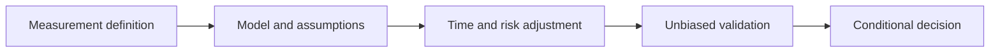

# From descriptive financial arithmetic to identified and validated models

[Subject home](../README.md) · [Foundation course](README.md) · [Practicals](../02-practicals/README.md)

These are educational model families, not investment recommendations. Each adds assumptions; a sophisticated backtest is not evidence of guaranteed profit.

## Read the motivation, mechanism and trade-off together

| Family / transition | Limitation or question | How the method works | What remains / why another branch matters | Read |
|---|---|---|---|---|
| Nominal comparison → real/index-adjusted measurement | Price levels change the ruler used for money values. | Deflate under a defined index/base and align periods/currencies. | Indices, population differences and data revisions affect interpretation. | [Lesson](lesson-03-macro-measurement.md) |
| Undated totals → discounted cash flow / NPV | Different payment dates are not directly comparable. | Discount each cash flow under explicit rate/timing assumptions. | Forecast/rate uncertainty can reverse the conclusion; IRR can be ambiguous. | [Lesson](lesson-04-cashflows-and-statements.md) |
| Single return average → compounding / path risk | An average hides changing bases and drawdowns. | Multiply gross returns and measure peak-relative path declines. | Historical volatility/drawdown do not bound future losses. | [Lesson](lesson-05-returns-and-risk.md) |
| Independent assets → covariance / factor / portfolio models | Dependence determines combined variation. | Model joint exposure and optimize a specified constrained objective. | Estimated covariances/premia are unstable and costs/constraints matter. | [Lesson](lesson-05-returns-and-risk.md) |
| Constant variance → ARCH/GARCH / stochastic volatility | Risk can cluster even with weak mean predictability. | Model conditional variance or latent volatility under a chosen distribution. | Variance prediction is not directional profit prediction; tails/regimes can break assumptions. | [Lesson](../../06-time-series-and-forecasting/01-theory/algorithms/12-volatility.md) |
| Raw associations → experiments / causal or time-series identification | Simultaneous decisions and confounders distort response estimates. | Use a justified design/model with overlap and timing assumptions. | An impressive coefficient or p-value does not itself establish an intervention effect. | [Lesson](lesson-02-markets-and-elasticity.md) |
| Selected in-sample strategy → temporal cost-aware backtest | Repeated search and future inputs create fictitious skill. | Freeze choices, respect information vintages and simulate plausible net execution. | Untouched history still cannot guarantee future profitability or capacity. | [Lesson](lesson-06-backtest-and-risk-controls.md) |

## How to compare alternatives

Use the same task, eligible data, split/horizon and compute budget. State the objective, assumptions, training/update procedure, important settings and failure cases. A newer publication can address one bottleneck while being worse on another. A survey row identifies a family; it does not pretend to derive every research variant.

For a method you study, complete this sentence: “I would consider it because ___; it works by ___; I would compare it with ___ using ___; I would avoid or investigate it when ___.” Recalculate the worked examples before selecting by a method name.
