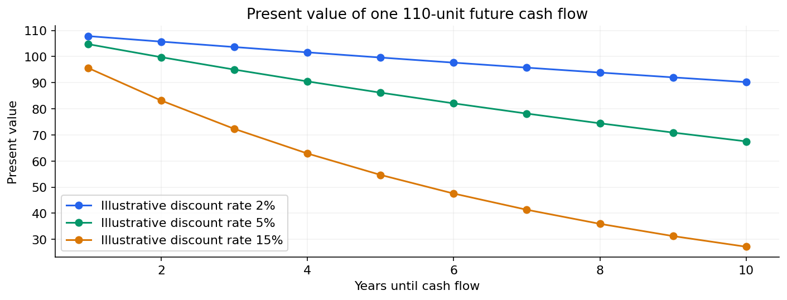

# 04 — Cash flows, discounting, NPV and financial statements

[Course map](README.md) · [Practicals](../02-practicals/README.md) · [Questions](../03-questions-and-answers/worked-questions.md#lesson-04)

Present value changes with both timing and discount assumptions. See the worked example for its assumptions.

## On this page

- [The idea](#the-idea)
- [Work through it](#work-through-it)
- [Common mistakes and practical limits](#common-mistakes-and-practical-limits)

## The idea

**Analogy:** Discounting translates dated cash flows into a common time unit for comparison.

A present value under a stated discount rate is $PV=CF_t/(1+r)^t$. NPV sums discounted inflows and outflows using a time convention and assumptions about risk/rate. A positive calculated NPV means value relative to those assumptions, not a guaranteed profitable outcome. Sensitivity analysis shows how conclusions change when uncertain inputs vary.

Income statements, balance sheets and cash-flow statements answer different questions. Revenue is not cash collection; profit is not cash flow; assets/liabilities/equity describe a point-in-time accounting position under defined rules. Working capital, depreciation and financing can separate accounting earnings from cash availability.

Rates need a compounding convention and consistent periods. Annual nominal, effective and real rates differ. Comparisons should include fees, timing and uncertainty where relevant. These notes use simplified educational arithmetic rather than investment or tax recommendations.

## Work through it

Pay 100 now and receive 110 one year later. At a 5% illustrative discount rate, PV=110/1.05≈104.76 and NPV≈4.76. At 15%, PV≈95.65 and NPV≈−4.35. The conclusion changes with the hurdle assumption.

If 100 revenue is earned on credit today but collected next month, the timing of revenue and cash differs.

## Common mistakes and practical limits

Do not mix monthly cash-flow timing with an annual rate without conversion. IRR can be ambiguous for unusual sign-changing cash flows. Future estimates should be labelled as assumptions, not known facts.

---

[← GDP, inflation, real values, rates and economic data](lesson-03-macro-measurement.md) · [Compounding, volatility, drawdown, diversification and factor ideas →](lesson-05-returns-and-risk.md)
