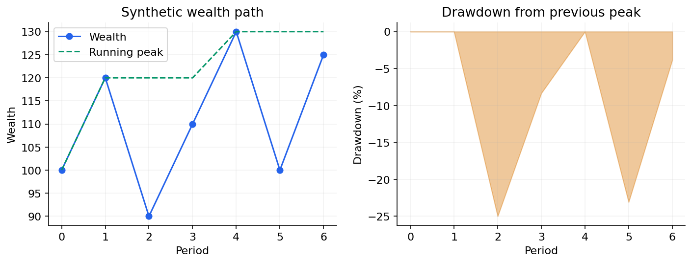

# 05 — Compounding, volatility, drawdown, diversification and factor ideas

[Course map](README.md) · [Practicals](../02-practicals/README.md) · [Questions](../03-questions-and-answers/worked-questions.md#lesson-05)

Compounded wealth and drawdown describe different aspects of the same path. See the worked example for its assumptions.

## On this page

- [The idea](#the-idea)
- [Work through it](#work-through-it)
- [Common mistakes and practical limits](#common-mistakes-and-practical-limits)

## The idea

**Analogy:** Returns compound along a path; a smooth average can hide an unpleasant journey.

Simple return is $(P_t-P_{t-1}+D_t)/P_{t-1}$ under a specified price/distribution convention. Compound wealth multiplies factors $(1+r_t)$. Log returns add when defined on positive value ratios. Arithmetic and geometric averages answer different questions.

Volatility measures variation, not every kind of risk. Drawdown compares wealth with its previous peak; maximum drawdown is a historical path statistic, not a worst possible future loss guarantee. Diversification depends on dependence as well as individual variances, and correlations can change in stress periods.

Risk-adjusted ratios need stated risk-free benchmarks, sampling frequency and dependence assumptions. Annualizing with a square-root-time rule is not universally valid under serial dependence or changing volatility. Factor models describe systematic exposure under a model; they do not establish that estimated premia persist. Treat all examples as measurement education, not portfolio advice.

## Work through it

Start 100,gain 10%,then lose 10%:100×1.1×.9=99, a 1% loss. Restoring 99 to 100 requires $100/99-1\approx1.01\%$.

Wealth[100,120,90,110]has peak 120 before 90, producing 25% drawdown. It later rises to 110 but has not regained that peak.

## Common mistakes and practical limits

Do not compare returns based on incompatible price adjustment/currency conventions. Survivor-only funds and assets can bias measured performance. A high historical ratio may reflect selection, leverage or hidden tail risk.

---

[← Cash flows, discounting, NPV and financial statements](lesson-04-cashflows-and-statements.md) · [Backtesting, costs, leakage, selection bias and model risk →](lesson-06-backtest-and-risk-controls.md)
