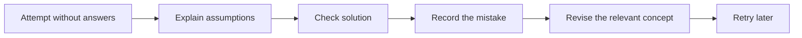

# Interview preparation: retrieve, solve and explain

[Subject home](../README.md) · [Theory index](README.md)

Use this subject for revision and timed practice. Learn the concepts in their main subject once; come here to retrieve them without prompts, solve a problem and explain a trade-off. Original question collections and published references are retained, with repeated files excluded from the main reading list.

## On this page

- [1. Use a consistent answer structure](#1-use-a-consistent-answer-structure)
- [2. Prepare in this sequence](#2-prepare-in-this-sequence)
- [3. Keep a short error log](#3-keep-a-short-error-log)

## 1. Use a consistent answer structure

State the problem in one sentence. Define inputs, outputs, units and assumptions. Present the simple baseline, then improve it if needed. Show a small example and explain failure cases. Finish with how the result would be checked. A concise, correct explanation is better than listing every algorithm name.

## 2. Prepare in this sequence

1. Python: collections, loops, functions, errors, iterators and small data transformations.
2. SQL: grain, joins, aggregation, windows and null behaviour.
3. Statistics: sampling, uncertainty, effect size and tests.
4. ML: split design, leakage, metrics, baselines and model trade-offs.
5. DL/NLP/AI: forward/backward computation, representations, retrieval and evaluation.
6. Business cases: measurable objective, data availability, decision cost and communication.

Do coding practice by running examples and edge cases, not only by reading. For SQL, state whether ties and missing periods should appear. For modelling, explain what information is available at prediction time. For a business case, define the denominator before computing a percentage.

## 3. Keep a short error log

| Question | What went wrong | Correct idea | Retry task |
|---|---|---|---|
| Overall margin | Averaged row percentages | Divide total profit by total sales | Recalculate with unequal revenues |
| Rare-event classifier | Reported accuracy only | Inspect precision, recall and cost | Build a confusion matrix |
| Monthly growth | Compared incomplete month | Align observation periods | Add a completeness flag |

Choose a few weak topics per session. Retry with a changed example so you learn the reasoning instead of memorizing the answer. Existing interview books/articles remain reference material in the archive; the main theory and worked answers are original teaching notes in this hub rather than copies of those publications.

[Try the practicals](../02-practicals/README.md)
