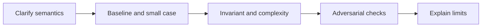

# A problem-solving story: baseline, invariant, optimization and verification

[Subject home](../README.md) · [Foundation course](README.md) · [Practicals](../02-practicals/README.md)

Interview preparation should make the reasoning transferable. The subject algorithms live in their main chapters; this page explains how to connect them instead of duplicating every answer.

## Read the motivation, mechanism and trade-off together

| Family / transition | Limitation or question | How the method works | What remains / why another branch matters | Read |
|---|---|---|---|---|
| Guessing an answer → explicit contract | Ambiguity makes a correct-looking solution solve the wrong task. | Clarify input/output, ties, missing values and resource constraints. | A memorized answer is fragile when one assumption changes. | [Lesson](lesson-01-structured-solving.md) |
| Brute force → maintained invariant | Repeated work suggests a reusable state. | Use frequency maps, prefix sums, windows, stacks, heaps or graph frontiers with a stated invariant. | Each pattern has assumptions; negative numbers or weighted edges can invalidate a familiar shortcut. | [Lesson](lesson-02-coding-and-sql-rounds.md) |
| One metric → structured diagnosis | A business or ML score can hide several causes. | Decompose definitions, data availability, split, baseline and error slices. | A model name is not a system design or causal explanation. | [Lesson](lesson-03-statistics-ml-cases.md) |
| One successful attempt → spaced retrieval and changed examples | Memorization can imitate understanding. | Record the misconception, retry without the solution and transfer to a new example. | Repeat the principle, not just the wording or exact test input. | [Lesson](lesson-04-systems-and-project-stories.md) |

## How to compare alternatives

Use the same task, eligible data, split/horizon and compute budget. State the objective, assumptions, training/update procedure, important settings and failure cases. A newer publication can address one bottleneck while being worse on another. A survey row identifies a family; it does not pretend to derive every research variant.

For a method you study, complete this sentence: “I would consider it because ___; it works by ___; I would compare it with ___ using ___; I would avoid or investigate it when ___.” Recalculate the worked examples before selecting by a method name.
