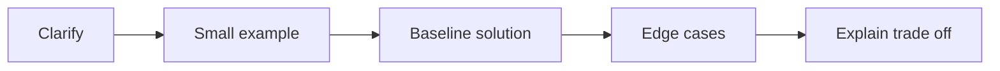

# 01 — Clarify questions, reason aloud and check edge cases

[Course map](README.md) · [Practicals](../02-practicals/README.md) · [Questions](../03-questions-and-answers/worked-questions.md#lesson-01)

## On this page

- [The idea](#the-idea)
- [Work through it](#work-through-it)
- [Common mistakes and practical limits](#common-mistakes-and-practical-limits)

## The idea

**Analogy:** An interview answer is a short guided proof: make the route and its assumptions visible.

Restate the question, clarify inputs/outputs and constraints, then solve a small example. For coding, identify edge cases and a simple correct baseline before optimization. For analysis, specify the target, unit, time window, comparison and denominator. For ML, define prediction time, split, baseline and error costs before naming an algorithm.

Explain trade-offs without narrating every keystroke. State time/space complexity with the operations and data structures that justify it. Check empty input, duplicates, missing values, ties and extreme sizes. If uncertain, state the assumption and what evidence would resolve it rather than bluffing.

Practice retrieval: attempt from memory, inspect the solution, identify the exact misconception and retry a changed example. An error log should record a principle and a follow-up problem, not a copied page of answers. The original question collections remain in this subject, while detailed concept teaching stays in its home subject to avoid inconsistent duplicates.

## Work through it

Asked“find the second largest”: clarify whether duplicates count. For[5,5,3], the second distinct value is 3 but the second element in descending order is 5. A technically correct solution to the wrong definition is still wrong for the task.

## Common mistakes and practical limits

Do not optimize before agreeing on semantics. Avoid claiming O(1) space while constructing a full sorted copy. Memorized wording without a worked example is fragile.

---

[Subject home](../README.md) · [Coding and SQL interview patterns →](lesson-02-coding-and-sql-rounds.md)
