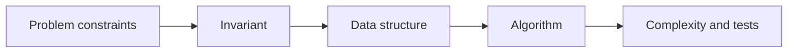
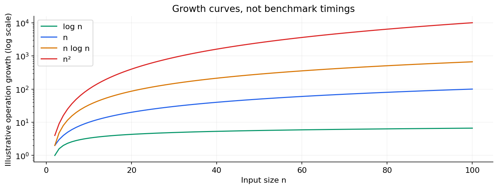

# 02 — Coding and SQL interview patterns

[Course map](README.md) · [Practicals](../02-practicals/README.md) · [Questions](../03-questions-and-answers/worked-questions.md#lesson-02)

Input growth changes algorithm cost very differently. See the worked example for its assumptions.

## On this page

- [The idea](#the-idea)
- [Work through it](#work-through-it)
- [Common mistakes and practical limits](#common-mistakes-and-practical-limits)

## The idea

**Analogy:** Patterns are reusable tools, not permission to force every problem into the same shape.

Common coding patterns include frequency maps, two pointers, sliding windows, prefix sums, binary search, stacks/queues, recursion and graph traversal. Identify the invariant each maintains. A sliding window needs a condition that supports advancing boundaries; negative numbers can break naive positive-sum assumptions.

SQL rounds often test grain, joins, NULL handling, aggregation, windows and temporal reasoning. Explain ties in ranking, duplicate keys and which timestamp defines latest. Write a tiny adversarial table to validate a query. A query that works only because the sample lacks duplicates is not robust.

Analyse complexity in terms of relevant input sizes. A hash-map method may have average linear behaviour but use additional memory; sorting can simplify logic at O(n log n). Recursion uses call-stack space. Prefer a readable correct solution with stated trade-offs to clever but unverified code.

## Work through it

Two-sum: maintain a map from seen value to index. Before insertingx, check whethertarget−xwas seen. Checking first prevents using the same occurrence twice. For[3,3]andtarget 6, the second 3 finds the first.

SQL latest-per-customer uses a window ordered by event time plus an appropriate tie-breaker, not MAX(amount) mistaken for the latest amount.

## Common mistakes and practical limits

A familiar pattern's assumptions must match the input. Do not forget NULL/ties simply because a toy query passes. Complexity claims should include extra containers and recursion depth.

---

[← Clarify questions, reason aloud and check edge cases](lesson-01-structured-solving.md) · [Statistics, ML and business-case interviews →](lesson-03-statistics-ml-cases.md)
