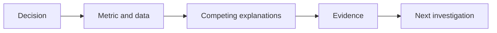

# 03 — Statistics, ML and business-case interviews

[Course map](README.md) · [Practicals](../02-practicals/README.md) · [Questions](../03-questions-and-answers/worked-questions.md#lesson-03)

## On this page

- [The idea](#the-idea)
- [Work through it](#work-through-it)
- [Common mistakes and practical limits](#common-mistakes-and-practical-limits)

## The idea

**Analogy:** A case interview asks for a decision process, not a recital of algorithm names.

For an experiment case, identify randomization unit, target effect, primary metric, guardrails, power and stopping policy. For an observational analysis, separate prediction/association from intervention claims. Explain what data could distinguish competing explanations.

For an ML case, define output/action, available features, label construction, temporal/group split, baseline, metric and serving constraints. Discuss leakage, label delays, imbalance, calibration and error slices. Choose a small candidate set with meaningful differences rather than listing every estimator.

For a business decline case, decompose the metric into drivers and check measurement changes first. Revenue can change through users, transactions per user, units per transaction, price and mix. Separate within-segment changes from composition effects. End with a prioritized next investigation/action and what result would change your recommendation.

## Work through it

Conversion falls from 10% to 8%. First verify tracking, eligibility and traffic mix. If a new channel brings many low-intent users, overall conversion may fall while each existing channel remains stable. A pooled before/after comparison alone does not prove the checkout redesign caused the decline.

## Common mistakes and practical limits

Do not promise causality from a correlation. “Use XGBoost”is not a complete solution design. A metric definition change can imitate a product failure.

---

[← Coding and SQL interview patterns](lesson-02-coding-and-sql-rounds.md) · [System design, project narratives and mock practice →](lesson-04-systems-and-project-stories.md)
