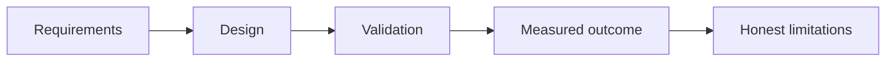
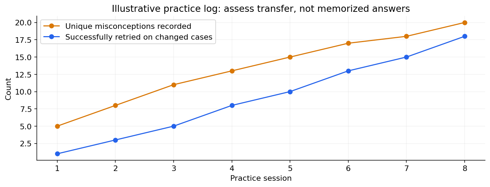

# 04 — System design, project narratives and mock practice

[Course map](README.md) · [Practicals](../02-practicals/README.md) · [Questions](../03-questions-and-answers/worked-questions.md#lesson-04)

A cumulative error log makes review progress visible. See the worked example for its assumptions.

## On this page

- [The idea](#the-idea)
- [Work through it](#work-through-it)
- [Common mistakes and practical limits](#common-mistakes-and-practical-limits)

## The idea

**Analogy:** A project story should connect a real problem to choices, evidence and lessons learned.

Start a system-design answer with requirements, scale, access and reliability expectations. Draw data flow, storage, compute, interfaces and monitoring. Discuss failure boundaries, idempotency, latency and recovery. Quantify assumptions rather than claiming a system scales to “millions”without a workload.

For a project story, state the problem, your actual role, the approach, trade-offs, evaluation and outcome. Distinguish measured results from aspirations and team work from personal contribution. For a learning project such as an assistant-built application, explain specification, review and verification work honestly rather than presenting generated code as unexplained expertise.

Mock sessions should include timed attempts and deliberate follow-up. Score correctness, clarity, assumptions, verification and trade-offs. Use the subject question banks for retrieval practice and the original interview collections for varied phrasing; revisit source lessons when an explanation is weak.

## Work through it

A10-minute project walkthrough:1 minute problem/users,2 data and constraints,3 design and alternatives,2 verification/results,2 limitations and next steps. These are practice allocations, not interview rules. If no production deployment occurred, say it was a prototype and describe the checks actually performed.

## Common mistakes and practical limits

Do not invent impact numbers. A diagram with many technologies is not evidence of a coherent design. Avoid memorizing a story that cannot survive questions about your own implementation choices.

---

[← Statistics, ML and business-case interviews](lesson-03-statistics-ml-cases.md) · [Continue with practicals](../02-practicals/README.md)
